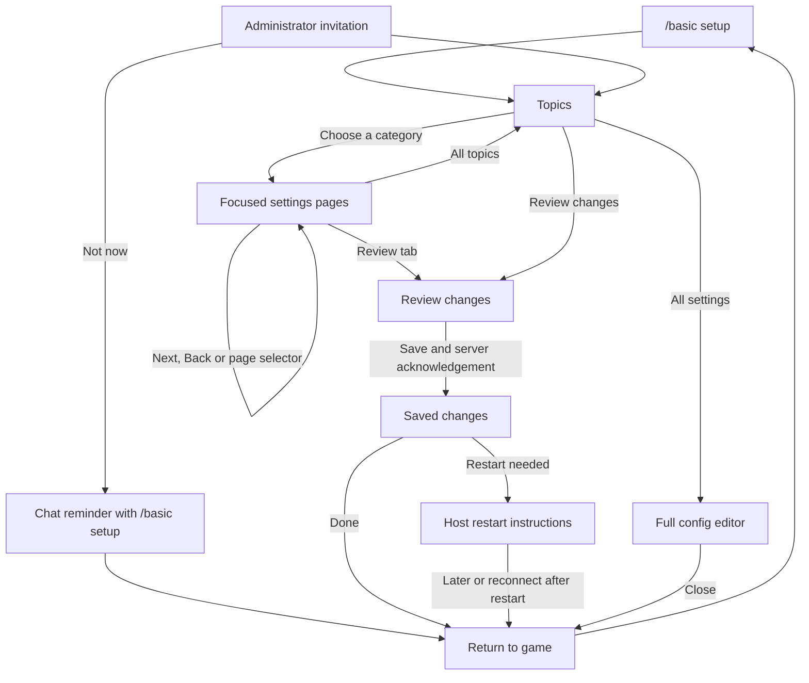
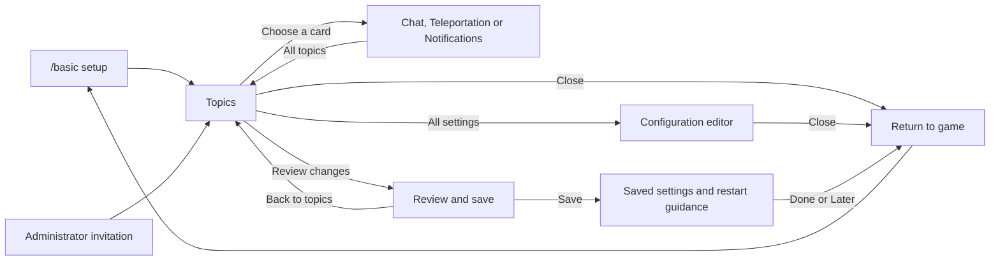

# Visual setup wizard QA

Worktree: `.codex-worktrees/visual-config-wizard`, branch `codex/visual-config-wizard`.
Scope: hierarchical configuration, invitation, restart guidance, native Pip preview and capture, integrated config search and proximity tab placement.
Game: 1.22.7. Source and package SHA-256 are recorded beside the staged build in ignored `.tmp`.
Retire this packet after the first release completes these cards and moves remaining findings to tracked work.

## Direct category tabs, October 13

The owner asked to switch between any of the eight categories from the top bar. All eight category tabs now stay visible between Topics and Review. Each category returns to its last visited page, and hub cards use the same remembered page. Draft edits remain shared across categories. The tab labels keep their full English titles with slightly smaller type and tighter spacing.

All 24 wizard preview tests passed, zero failed or skipped. Native mouse-click tests switch directly across all categories, preserve the draft, resume each last page, and select Review by label. Measured tab ends use 817 logical pixels at scale 1 and 833.8 at scale 1.25, below the 870 limit, with zero scroll offset. Independent source review found no navigation or reentrant-composition blocker. This changes navigation only; the 40-page catalog and saved configuration format stay the same.

Evidence: `.tmp/wizard-all-tabs-20261013/`, including the TRX, measured widths, all 23 standalone scenes at scales 1 and 1.25, build and QA receipts. Process-stop receipts are retained in `.tmp/wizard-all-tabs-processes-20261013/`. The canonical build has zero errors and 175 warnings. Source identity is `004f9257e7facb1129068412eecd4d28e446f4f267589635ce57ee2f7c3c83de`; package SHA-256 is `d70481e9809f07b8b30fce2312f8c5ca56a807e1163afa59ee24b4e757808b7f`. Server readback and both client profile zips match. QA reached RunGame at 16:22:03 UTC on October 13, with no startup exceptions beyond the previously documented warnings and container-path error.

Four source-verified native captures cover the hub, Chat, Player display and Server tools at 1908x1260, scale 1.125. The inspected hub and stats page show the full top bar without clipping. Profile2's client log has no errors or exceptions. `controller-shutdown.json` confirms automation was disabled, leaving Profile2 connected for `/basic setup`; `profile3-launch.json` records Profile3's launch to its menu. Card 10 remains pending owner observation; no merge, release or screenshot-baseline approval occurred.

## Hierarchy expansion, October 13

The goal is to make every BASICs setting accessible through a hierarchy with useful explanations and previews. This revision expands the existing setup rather than treating its original three topics as the final scope.

- The hub now has eight cards in two rows: Chat, Teleportation, Notifications, Player display, Map visibility, Characters, Roleplay tools, and Server tools. Pip moves into the header. The shared catalog defines each branch, its entry page, and 40 focused pages. Its initial top bar showed Topics, the active branch and Review; the direct category tabs above supersede that navigation. Short new pages size their dialog to the controls and preview.
- New pages cover language access and signing; overhead speech, typing, names and colors; player maps; character sheets, access and slots; dice, scene markers, spectators and nickname choices; history, retention, staff and personal notes, and player stats. The original 19 page IDs remain valid. Six existing character-sheet fields are now registered for validated editing; no configuration fields or protobuf numbers were added.
- Contextual previews illustrate the selected feature. Display pages put a speech box, typing indicator or nametag above native Pip. Other new pages show a map, sheet, dice, notes, history or statistics panel. New language pages use the mock chat window. These illustrative panels are not the actual feature GUIs and do not establish gameplay behavior.
- Analytics accepts the catalog's bounded page IDs as wizard steps. The relay's finite step list now matches those pages, with contract revision 10 and the producer's required revision set to 10. Custom text, privileges and colors are still excluded from wizard event properties. Deploy relay revision 10 before releasing this producer: the revision-9 relay rejects new page IDs. The relay change is local; production rollout and PostHog ingestion are not verified here.

### Verification and retained evidence

- Full implementation suite: 1,359 passed, zero failed or skipped. After shortening the new dialogs, all 102 wizard/guide checks passed. Relay compatibility checks passed 29 Node cases and 23 targeted .NET cases, including catalog-derived finite acceptance, arbitrary-step rejection and revision alignment. The mock visual workflow passed 48 assertions, including new scene routing and source/protocol rejection. Agent tooling checks passed.
- All 23 standalone scenes rendered at scales 1 and 1.25. Native review found a collision between the `Blocks broken` label and its count in the stats sample; widening the shared preview value column fixed it without clipping the sheet or history values. The reviewed hub, display, map, character, dice, history and statistics samples fit their bounds. Final stamped captures and handoff receipts are recorded below.
- Final source identity: `e0cae415d598f147ac994240818ce170686d5a9ea8a2ada3d0d13ed8e2313582`. Package SHA-256: `96d96f839eb32892787684bd964500a4a924ae3e4be3a3b10b34bdf159c0b981`. The canonical build completed with zero errors and 175 warnings. Server package readback and both profile zips match. QA restarted with all BASICs systems loaded and reached RunGame at 09:04:08 UTC on October 13. The relay Worker itself was not deployed by QA staging.
- `native-relay10/captures.json` records all 23 final native scenes, Profile2, pipe `vintage-story-agentcontrol-profile2`, and the final source identity. Every manifest has `native-client` coverage and verified source identity at 1908x1260, scale 1.125. Final hub and stats images were re-inspected. Profile2's client log contains no errors or exceptions.
- Evidence lives in `.tmp/wizard-branches-20261013/`: TRX/logs, standalone renders, native manifests, build receipts, stage backups/journal/recovery mapping, and client launch receipts. Superseded evidence stays in place; only the final stamped package is used for handoff.
- Handoff: `controller-shutdown-relay10.json` confirms the automation session was disabled, leaving Profile2 connected for `/basic setup`. `profile3-final-launch.json` records Profile3's visible launch to its menu; it was not connected automatically. The original GUI scale is unchanged. The temporary helper stays installed for ongoing QA; its restoration receipt is `.tmp/qa-main-20261012-1791837188457/profile/profile-receipt.json`. No screenshot baseline was approved and no merge or release was performed.
- Existing Flywheel duplicate warnings and the bare `/home/container` startup error predate this revision. They remain outside this change. The final server startup contains no exceptions.
- New human cards 10 through 14 below remain pending. Native images establish captured appearance, not owner acceptance, real-time animation feel, saves, permission enforcement or actual feature behavior.

### Remaining hierarchy work

The eight branches are the first expansion, not full configuration coverage. Next, bring variable-length language and character-field editors into their branches, add chat formatting/audio submenus and integration-aware settings, and add presets after their effects are tested. Diagnostics should be reachable deliberately rather than mixed into ordinary Server tools. Full coverage must preserve existing saved values and review only the settings an administrator changes.

The source audit also identified existing behavior to resolve before adding its controls:

- Individual player-stat switches are marked live in the registry, but several runtime subscriptions are selected only at startup. Enabling a counter that was off at boot may not subscribe it; some handlers ignore later disabling. This wizard exposes overall tracking with restart guidance and the clearing privilege, leaving individual counters in the full editor until their lifecycle is corrected.
- The optional custom nametag renderer does not reliably restore the vanilla texture when switched off, and delayed headshot callbacks can replace textures without rechecking it. Names, targeting, range and line-of-sight settings still apply through the vanilla path. The renderer switch is not included in this revision.
- Semantic language learning needs its provider/atlas configuration, and RP TTS depends on another mod. Future menus need to represent those dependencies. Repair has no existing configurable module switch; do not invent one for menu completeness.

## Topic cards and footer, October 12

- Owner feedback identified the boxed Close footer, detached Review changes action, and plain topic choices. The hub now uses three complete clickable cards with Cairo pictograms, titles, integrated descriptions, warm borders and native hover/focus/pressed states. Review changes, All settings and Close share the footer row, separated from the body by a thin rule. The hub is 78 logical pixels shorter; Pip stays above the footer. Other pages retain their existing navigation and dimensions.
- All settings stays visible but disabled when a fixture has no editor callback. It remains enabled in the normal wizard. The unsaved count yields to pending-save or failure text, and hub status text stays left of Pip.
- Existing navigation is preserved; this revision changes its layout:

- Full initial layout suite: 1,344 passed, zero failed or skipped. After the status-overlap correction and its two new scale cases, all 90 wizard/guide checks passed. Tests exercise card description-area clicks, footer spacing, All settings dispatch, the Close discard confirmation, and pending/failure status precedence at scales 1 and 1.25. Independent source review checked native input, reentrant navigation and texture cleanup. All 16 standalone scenes render at both scales. Final canonical build: zero errors, 158 warnings.
- Source identity: `33102251b062088632e26a7f2016defd7268c8e6a741cc2dbe16c2b15a9f29b1`. Package SHA-256: `6dcfc1350b82da6e578ef7a365d6075fdf895179744e4c307a196373b26ec002`. QA server readback and Profile2/Profile3 match. The fresh RunGame marker is 03:20:04 UTC on October 13 (October 12 locally). No startup exceptions; the Flywheel duplicate warning and bare `/home/container` error were present before this staging.
- Evidence: `.tmp/wizard-hub-style-20261012/`, including TRX files, standalone renders, build receipt, staging backups/journal/recovery mapping, launch receipt and all 16 source-verified native captures at 1908x1260 and the original GUI scale 1.125. The inspected hub shows integrated card content, aligned footer actions, and clothed Pip within bounds. Profile2's client log has no errors or exceptions. The controller was disabled after capture, leaving Profile2 connected for `/basic setup`; Profile3 was relaunched to its menu. Native gesture feel, gameplay save/restart checks and owner acceptance remain pending.

## Copy revision, October 12

- Owner feedback rejected the earlier hub and explanatory copy. The hub now uses one instruction, removes repeated topic names, hides the empty change count, and names the full configuration route `All settings`. Page descriptions, shared setting labels/help, presentation options, travel examples and save/restart messages were rewritten. The reviewed source corrects language gates, cost timing and timeout wording without changing config keys or reload behavior.
- Review now shows sleep thresholds in the same percentage units as the control. Unlimited speech no longer draws a misleading distance-fading boundary. Those changes have native-widget regressions at scales 1 and 1.25.
- Initial copy revision: 1,342 tests passed, zero failed or skipped. All 16 wizard fixtures render at scales 1 and 1.25. The canonical local-only package builds with zero errors and 153 warnings. Source identity: `bb68356bc0349c9547bd2b986227997af6e26c1e35870916470d336a2e382305`; package SHA-256: `8e9ac2ca2f814685426297c74e5f945ce47c607142da4660e037cc91ec30df38`. Evidence: `.tmp/wizard-copy-20261012-1791856876473/`, including final TRX, standalone PNGs/manifests and build receipt. Those renders explicitly omit native Pip.
- Follow-up tooltip audit removed the remaining three uses of `startup-shaped` and development-work notes from 12 shared setting rows. Labels and help now describe actual effects. Source review corrected two claims: disabling nicknames does not hide saved nicknames, and the language limit applies to `/addlang`, while staff grants and learning through speech can exceed it. Config keys, options, groups, validation, reload behavior and executable registry code are unchanged. The old TPA tooltip in the owner's screenshot was already absent from the initial copy revision.
- Follow-up validation: all 110 focused wizard/config checks passed. After the final language-help correction, all 37 registry checks passed again. The final canonical local-only package builds with zero errors and 153 warnings. Source identity: `663656a0a8dd31e81bd25836cb53fbe9d498922e59e6f265b68c52dcbce8adbe`; package SHA-256: `6f10261b960d5b1a46a76233f9591e288703aa495dde19d1f863df2aa16d2d6c`. The earlier full suite and standalone images are separate evidence, rather than reruns of this metadata-only follow-up.
- Owner explicitly authorized discarding any QA draft and killing the test clients. Both verified profiles were stopped before staging. QA server readback and both profile packages match the final hash. The server reached a fresh RunGame marker at 02:33:28 UTC on October 13 (October 12 locally), with all BASICs systems and no startup exceptions. The Flywheel duplicate warning and bare `/home/container` error were present before staging.
- Current evidence: `.tmp/wizard-copy-refresh-20261012/`, including `build-final.json`, TRX files, package/profile backups, staging journal and recovery mapping, launch receipt and all 16 verified native captures. Every capture reports the final source, native-client rendering, 1908x1260 and the original GUI scale 1.125. Inspected hub, chat/presentation, travel, notifications, sleep, review and dedicated restart samples show readable copy without visible clipping. Profile2's client log contains no errors or exceptions.
- The controller session was disabled after capture, leaving Profile2 connected for `/basic setup`. Profile3 was relaunched to its menu. The helper remains installed with the preceding preparation receipt's guarded restoration path. No server config or GUI scale was edited. These captures do not complete the invitation, actual save/restart, chat gameplay, gesture-feel or human copy-acceptance cards below.

## Main integration, October 12

- Integration target: `origin/main` at `26069b4`, which adds configurable chat-history formatting isolation from PR #254.
- The initial combined config assigned protobuf field 159 to both `ProximityChatTabPosition` and `IsolateChatMessageFormatting`, reproducing a duplicate-field serialization failure. The correction keeps main's shipped isolation setting at 159 and moves the unpublished tab-position setting to 160. `CharacterSheetAutoOpenOnCharacterScreen` stays at 158.
- The wizard's mock chat window uses its own rich-text element. The incoming patch affects the actual chat HUD, so earlier wizard screenshots do not verify it. Cards 8 and 9 below cover the actual HUD and preservation of the isolation setting across a wizard save.
- Combined suite: 1,338 passed, zero failed or skipped, with the installed GUI assets. Published-field roundtrips cover isolation at 159 in both directions and the independent tab-position value; an unrelated wizard edit preserves a subsequently disabled isolation setting. Helper reconstruction and preparation pass all 23 acceptance tests. The canonical package builds with zero errors and 151 warnings.
- Source identity: `ba5b4d3ef72911e4f2b5720e14a7c97ea22d38c5a62dd2dc0328105c25968101`. Package SHA-256: `79590c0b2654745a09154c908ed9b793a2221cbda3947f4ea37df7421ec318f7`. Server readback and both profile packages match. QA reached a fresh RunGame marker at 20:38:45 UTC on October 12. No startup exceptions; the Flywheel duplicate warning and bare `/home/container` error were already in the pre-stage log.
- Run directory: `.tmp/qa-main-20261012-1791837188457/`. It retains the build receipt, helper/profile backups, staging journal and recovery mapping, launch receipt and all 16 source-verified native captures at 1908x1260 and the original scale 1.125. Inspected Topics, chat/presentation, ranges, travel and notification samples have no visible blocker. Owner observations remain pending; no human card or QA completion is claimed by these automated checks.
- `clip/wizard-hub-sampled.mp4` contains nine verified native poses (2.25 seconds including the last pose interval). The arm is lowered at time 0, raised at 1 second, and lowered again at 2 seconds. FFprobe confirms dimensions, H.264, frame count and duration. This establishes sampled appearance, not smoothness or drag behavior. Profile2 is left connected after disabling the controller session; Profile3 is relaunched to its menu. The temporary helper remains provisioned, with its guarded restoration receipt under `profile/`. Server settings and the original GUI scale were not changed by these captures.

## Empty preview input, October 7

- Removed the `Example chat` filler from the shared mock chat input. The native input starts empty and remains disabled, with its separator and background intact.
- All 12 affected chat preview checks pass with no skips, including an empty-input assertion. Canonical build: zero errors, 151 warnings. Source identity `29ac1ff7fafb71df6a03d1d40004e987afdddca619e4e2a37393adfe754ee684`; package SHA-256 `89e3d870be2b211f9a3d8777102a830cf0df89ba5cef9a1b1e04fbeff30b3379`. QA server readback and both profile packages match. The server reached RunGame at 05:30:23 UTC with no startup exceptions and the existing bare container-path error.
- Fresh native capture `.tmp/wizard-native-empty-input/wizard-chat-default.png` reports this source stamp, native-client coverage, 1908x1260, and GUI scale 1.125. Model inspection confirms the blank input. Profile2 is left on Chat; client logs contain no errors or exceptions. Earlier full suites and capture sets below are separate evidence; owner QA cards remain pending.

## Contextual preview revision, October 7

- The closed presentation dropdown contains its English title and smaller description in the same 58-pixel row as the open choices. Both rows center the entire text block. The drag hint and separate description label are removed.
- Chat basics, language, and tab settings show only the mock chat window. Hearing ranges and obfuscation show only their diagram. Teleportation shows its diagram and explanation. Pip greets and idles on Topics, retaining drag and release momentum there.
- Save options are Off / Chat / Chat notification. The existing notification flags send beige text (`#CCe0cfbb`) to General, rather than a separate popup. Their mock history follows the selected mode and escaped custom wording. Sleep previews cycle zero through three sleepers out of four, retaining the ordinary chat reminder after a threshold crossing until the loop resets; 0% and 100% stay silent.
- Full suite: 1316 passing tests, no skips. A subsequent 12-test chat run includes every teleport page and the hub. Native widget checks cover matching selected/open row layout, clipping, keyboard/focus behavior, save mode callbacks and text edits, contextual element presence, and sleep thresholds at 0/25/50/75/100%.
- Canonical build: zero errors, 151 warnings. Source identity `4b42c0f59883ffd3d5b1f3ca3f68d38960e4c2506c8ca7aed3e6da6489404450`; package SHA-256 `9a71f93ba4ffda4590b3a632bf36f7b97bee5cffc97c132248cb7b09006d5c3f`. QA server readback and both client profile zips match. The server reached RunGame at 05:12:53 UTC with no startup exceptions; the existing flywheel duplicate warning and bare container-path error remain.
- CPU report `.tmp/wizard-ci-contextual-report/report.json` records 32 additions with valid evidence at scales 1 and 1.25. The named set adds Topics and Sleep fixtures. These images omit native character rendering; they are separate from client captures. All 16 mocked capture receipts passed their protocol checks.
- All 16 fresh native scenes in `.tmp/wizard-native-contextual-set` report native-client coverage and this source stamp, at 1908x1260 and GUI scale 1.125. Model inspection confirms the closed/open described dropdown, chat-only pages, range-only diagram, save notification styling, travel layout, and Topics character. Client logs contain no errors or exceptions.
- Additional native captures in `.tmp/wizard-native-contextual-wave` and `.tmp/wizard-native-contextual-sleep` show the raised greeting at 1.5 seconds and the 50% reminder at two sleepers at 4.5 seconds. The final `.tmp/wizard-native-contextual-chat` capture leaves Profile2 on the live Chat page. Capture completion resumes animation. These are sampled poses and the tested resume path, rather than owner acceptance of gesture feel or smoothness.
- Owner observations and the manual cards remain pending. No merge or release is authorized by the automated checks.

## Chat window and interaction revision, October 6

- Chat now previews a complete miniature native chat window, with General/Proximity tabs, clipped history, scrollbar, and a disabled example input. It owns no live chat history and sends no chat. General replacement removes the mock Proximity tab; local OOC follows the nickname choice; the default-tab page starts without a remembered player tab.
- Presentation choices use English names and smaller descriptions in expanded rows. Topic tabs and an inset footer organize navigation. Ordinary pages omit restart suffixes; review identifies `After restart`, and the acknowledged-save screen retains the host-specific instructions.
- Pip supports horizontal drag, release momentum with bounded exponential decay, and gesture cancellation when changing pages, closing, suspending, or disposing. Native wave and idle animation remain live; named captures reset orientation and pin a pose, then resume live animation after capture.
- Full suite: 1310 tests passed, no skips. After the default-tab correction, all 33 affected checks passed; after the final copy/tooltip correction, all 8 chat checks passed. Tests cover native menu row clicks and keyboard/focus behavior at scales 1 and 1.25, input isolation, preview clipping and nickname/default-tab choices, momentum/cancellation, and actual installed native joint movement beyond 5.5 seconds after capture resumes.
- Canonical build: zero errors, 152 warnings. Source identity `0c4a680a4fc2a5c00101d343e0b9ea16dde6348456779ecc43dca5b1bd7abeb1`; package SHA-256 `22ec5adba8e55af618dee1eea7884717498ccf36045deecb8af48db830152b38`. QA server readback and both profile zips match.
- CPU report `.tmp/wizard-ci-chat-window-report/report.json` records 28 additions with valid evidence at scales 1 and 1.25, including the new expanded `wizard-chat-presentation` fixture. CPU images omit native Pip. Earlier native images below do not certify this revision.
- The staged server reached RunGame at 01:01:43 UTC on October 7 (21:01:43 EDT on October 6). Startup has no exceptions; the existing bare container-path error remains. All 14 fresh native scenes in `.tmp/wizard-native-chat-window-set` report native-client coverage, the staged source stamp, 1908x1260, and the restored GUI scale 1.125. Native inspection confirms the full chat window, expanded English title/description rows, guide clipping, review, and restart pages. The client log has no errors or exceptions. The capture runner also completed all 14 mocked scene receipts.
- An additional raised-wave capture at 1.5 seconds is in `.tmp/wizard-native-chat-window-live`. It shows Pip's arm moving from the 0.75-second pose without leaving the panel. Its completed capture receipt runs `ResumePreview`, so Profile2 is left on the live Chat page with drag enabled. This proves the captured native poses and the resume path, not owner acceptance of gesture feel or real-time animation smoothness.

## Combined search checkpoint, October 6

- Integrated source commits `0c5aa0a`, `53e86fc`, and handoff `424982a` into the wizard branch. Preserve `CharacterSheetAutoOpenOnCharacterScreen` at protobuf field 158. After the October 12 main integration, `ProximityChatTabPosition` uses 160 and main's shipped `IsolateChatMessageFormatting` keeps 159. Search navigation and wizard hooks coexist.
- Combined suite: 1290 tests passed with no skips. A subsequent permission-denial fix passed all 62 affected checks, including two native GUI regressions. Failed language/field open result packets reopen the main editor, preserve its draft/query, and clear pending navigation.
- Canonical build: zero errors, 141 warnings. Package SHA-256 `59a59e0bbd1a6e5646502825007d0155bbac6cdfa7ae573a0287f525704fb699`, source identity `3ab79de9d2d8fb83bff5e4151a5edd05a47fed6f3a5a5a938195407c65bbadc4`. Server readback and Profile2/Profile3 match. The QA server reached RunGame at 23:59:10 UTC, with no startup exceptions and the existing unrelated container-path error/flywheel warning.
- Combined CPU report `.tmp/wizard-ci-combined-search-report/report.json` has valid evidence for 26 wizard additions at scales 1 and 1.25. Search CPU previews and focus/scroll/session checks are in `.tmp/combined-search-tests` and `.tmp/combined-search-denial-tests`. The wizard comparison collector does not currently include search scenes.
- Fresh native pilot and all 13 scenes are in `.tmp/wizard-native-combined-pilot` and `.tmp/wizard-native-combined-set`, at 1908x1260 and GUI scale 1.125. Every manifest reports native-client coverage and the combined source stamp. Model inspection confirms the rendered character, chat/tab examples, and dedicated restart instructions.
- Native scale probes in `.tmp/wizard-native-combined-scale-1` and `.tmp/wizard-native-combined-scale-1.25` cover Chat, Teleportation, and Notifications at their actual manifest scales. The 1.25 Chat poses at 0.75 and 1.5 seconds show the arm moving from lowered to raised, within the guide panel; the later pose is in `.tmp/wizard-native-combined-wave-1.5`. These are named poses, not real-time performance measurements. Profile2's original `floatSettings.guiScale=1.125` has been restored. Raw-preserving setting edits and verified backups are recorded in `.tmp/wizard-profile2-scale-backup-*/scale-receipt.json`.
- Search journey and five pending owner cards: [2026-10-06-config-search-qa.md](2026-10-06-config-search-qa.md). No in-game search roundtrip or human observation has been recorded for this combined source.

## Earlier native motion checkpoint, October 6

- Native motion checkpoint commit: `548bb84596fd86b26e9c763c58203799a65d4d2d`, pushed before search integration. The source identity below identifies this earlier evidence.
- Package: `thebasics_5_9_1.zip`, SHA-256 `7654294da2f5ead9c766b813578d90c7cbf1341d12ae446f95228b1f768b81fa`. Server readback and both profile packages match.
- Source identity: `e845a6c86dd96ad30cc3ce43e41e28d0ed83c706ba5669d421b9b3a5395363f3`, identical in the canonical build and 26 final CPU captures. Report: `.tmp/wizard-ci-native-motion-report/report.json`, 26 added scenes, valid evidence, no missing or stale frames.
- Verification: 1257 checks passed with no skips in the final motion suite; its new synthetic-joint test initially failed because the fixture omitted two required rotation axes, then passed separately after that fixture-only fix (1258 passing checks in total). The prior native camera-angle change also passed all 21 affected checks with no skips. Python report checks 15 passed, relay checks 28 passed, workflow trust checks 2 passed. Canonical packaging has zero errors and 132 analyzer warnings. Package after tests: test builds can invoke the mod's post-build packager and overwrite an earlier stamped zip.
- Server restarted and reached RunGame with all BASICs systems loaded and no exceptions. Existing flywheel duplicate warnings and a bare container-path error remain outside this change.
- Profile2 has a temporary Agent Control startup build. `EnableOnStartup=true` is enabled only in this profile, using pipe `vintage-story-agentcontrol-profile2`. It waits for player readiness and enables once; cancellation, disabling, RPC shutdown, and pipe failure cannot enable it again. All 23 bridge checks pass. Terminal requests cancel their extension tokens, including completed and failed requests, so queued captures cannot outlive their owner. PostHog ingestion and manual cards remain unverified; sampled video evidence is recorded below.
- Native recovery: PlayerModelLib renames the live player's skin behavior and suppresses vanilla clothing composition. Pip retains a private native skin descriptor and calls the original native compositor through the existing Harmony reverse-patch facility. The guide uses the character editor's native viewing angle. Constructor/composer cleanup preserves the original error, prevents a client crash, and retains a dirty draft if reopening fails.
- Motion recovery: named frames at 0.75 and 1.5 seconds exposed a frozen wave. The native animation engine decrements its iteration on a zero-time prime, which prevents this animation from easing in. The private animator now starts on a positive step and keys active animations by their native `Animation` field (`idle1` for the `idle` metadata). A real `ClientAnimator` regression checks time-zero identity, alias resolution, easing, and changing joint matrices.
- Earlier native evidence: `.tmp/wizard-native-motion-set` contains all 13 source-verified scenes at 1908x1260, GUI scale 1.125. Model inspection covers chat, ranges, languages, travel, notifications, and restart guidance. The later combined-source probes above add scales 1 and 1.25; owner observations remain pending.
- Video evidence: `.tmp/wizard-native-wave-clip/clip.json` records nine native poses at 0..2 seconds, sampled at 4 Hz and cropped to the wizard. The H.264 clip is 1038x730, nine frames, 2.25 seconds, SHA-256 `fc961c71b0ca7206a3e786c2ea6f31621c4184189d946d16f0b4e85c116008f7`. The authorized `gemini-3.1-pro-preview` call returned six PASS criteria in `wizard-chat-wave.review.md`. It establishes sampled appearance/motion/layout assessment, not real-time smoothness or human acceptance. Reproduction and rubric: [2026-10-06-wizard-video-rubric.md](2026-10-06-wizard-video-rubric.md).
- Player snapshots: before/after inventory aggregates and hotbar match with no truncated entries; position, pitch, ground state, and active slot match. Yaw changes by about 0.00666 radians, so the strict whole-player-state assertion fails. Retain `.tmp/wizard-native-player-check.json` as that limitation; do not mark the player-isolation human card complete.
- Launch discovery: Vintage Story forwards `-c` to an existing instance through a global URI pipe. An immediate second launch reached the first client before input initialization and caused vanilla `walkforward` startup failure. Launch Profile2 without `-c`, wait for the menu's shaders and controls, then run the connection command to forward to that initialized window. A second profile must also start without `-c` and connect from its own menu.
- WinSCP deployment requires Windows PowerShell for the installed .NET Framework assembly; using PowerShell Core fails before transfer. The successful transfer used the supported runtime and verified remote bytes before restart.

## Preparation and evidence

- Existing QA mod, config, startup log, and both client packages are backed up in `.tmp/wizard-qa-backup-20261006-160450`.
- Profile2 enables Agent Control automatically after player readiness. Its optional operations open capture-only wizard sessions; they cannot save settings or acknowledge the invitation. Ctrl+Alt+F9 still cancels, and Ctrl+Alt+F8 disables the session.
- Startup helper source is an isolated copy of `D:\bench\vs\work\s3-agentcontrol` at `ffab5508d10153f0dce3fe0073a94b9172d3a568`. The reproducible delta is [2026-10-06-profile2-startup.patch](2026-10-06-profile2-startup.patch), checked with `git apply --check --ignore-space-change`. Apply it in a disposable copy, then use that project's existing test and package commands. This temporary fork is not part of the BASICs release.
- Helper package SHA-256: `d6e46d05acc63aff308009b7b829a8ed8c5fa92117fa023543d6cb292bf982cc`. Original Profile2 helper zip and config are backed up in `.tmp/wizard-profile2-bridge-backup-20261006-230147`; the prior temporary helper is also backed up in `.tmp/wizard-profile2-bridge-backup-20261006-233158`. Staging receipt is `.tmp/wizard-profile2-bridge-stage.json`.
- Only Profile2's existing limits are raised to `MaxActionDurationMs=30000` and `MaxBatchDurationMs=60000`, because effective patched asset fingerprinting takes about 11 seconds on the render thread. Original limits are preserved in `.tmp/wizard-profile2-limits-receipt.json`'s backup. No release default changes. The capture must complete before its owning batch ends; a slow mesh load fails safely rather than writing later.
- Run the native capture batch with `./scripts/capture-native-wizard.ps1 -ExpectedSourceTreeHash (./scripts/gui-source-identity.ps1) -Vsctl D:\bench\vs\work\s3-agentcontrol\tools\vsctl\bin\Release\net10.0\publish\vsctl.exe -DataPath D:\Games\VSProfiles\Profile2`. Add `-Scenarios wizard-chat-default` for a pilot. Source stamps, fixed profile capture directories, and native coverage are validated before copying artifacts. Mock checks cover all 13 scenes and rejection of unknown scenes, wrong source hashes, and wrong profile directories.
- CPU renders cover 13 named scenes at two scales. They explicitly omit Pip. Native captures, analytics readback, and the observations below are separate evidence.
- Live collector health at 20:11 UTC on October 6 reports contract revision 8. It rejects the new wizard events until revision 9 is deployed through the existing Terraform production workflow. Ordinary supported events still flow; a producer success message is not proof that a wizard event reached PostHog.
- No card is complete until the owner reports the expected observation. No merge or release is authorized by this packet.

## Batch 1: current configuration, no restart

1. **Invitation and return command** (P1)
   - Config: current server settings; administrator has not acknowledged setup.
   - Do: connect, finish any character/consent dialog, then choose Not now or press Escape on the setup invitation. Enter `/basic setup` afterward.
   - Expect: one chat message, `You can configure The BASICs later with /basic setup.` The command opens the wizard with current settings. A declined invitation does not return after reconnecting.
   - Watch for: invitation covering character creation, duplicate reminders, or disconnect being treated as a decline.

2. **Native guide and repeated close** (P1)
   - Config: any; capture-only fixtures are sufficient.
   - Do: inspect Pip on Topics for at least ten seconds. Drag slowly, then flick and release, including outside the panel. Catch the moving preview with another drag. Change a setting, return to Topics, begin another drag, press Escape, and cancel discard. Change pages, close, and reopen several times. Repeat at GUI scales 1 and 1.25. Compare the live player's clothes and inventory before and after.
   - Expect: Pip has the selected skin and pastoral outfit, greets and returns to a moving idle, stays clipped inside the panel, and does not change the live player. Slow dragging turns Pip; a recent flick coasts smoothly to rest. A new drag catches the motion. Canceling discard preserves the draft and leaves no stuck gesture.
   - Watch for: invisible guide, stretched mesh, clipped controls, stalled animation, motion without a pressed button after cancellation, duplicated dialogs, inventory changes, or exceptions after closing during a mesh upload.

3. **Draft, review, and restart instructions** (P0)
   - Config: current General channel choice; note its original value.
   - Do: toggle Use General as proximity chat, review, save, then choose Later. Reopen setup and change it back to its original value, review and save again.
   - Expect: the first review names the exact changed setting and restart requirement. Success appears only after the server acknowledges it. Dedicated-host instructions explain restarting through the host and reconnecting; Later returns to the game. Reverting to the startup value clears that pending restart.
   - Watch for: a shutdown button presented as restart, lost edits, unrelated values changing, or success before acknowledgement.

4. **Travel options and conditional explanations** (P1)
   - Config: draft only; no save is necessary.
   - Do: disable homes, keep spawn enabled, and inspect Spawn's gear choice. In player requests, toggle the gear, cooldown and timeout controls Off and On. Close and discard the draft.
   - Expect: spawn's shared gear setting remains available. The examples describe only enabled charges and timing; labels distinguish real time from game time. Hidden tools preserve their settings.
   - Watch for: an unavailable spawn cost, examples claiming disabled costs or timing, or changes from merely visiting a page.

5. **Notification and sleep examples** (P1)
   - Config: draft only.
   - Do: try Off, Chat and Chat notification separately for save started and finished. Change their wording. Change the sleep percentage between 25, 50, 75, 0 and 100. Close and discard.
   - Expect: save pages show only General chat. Off leaves its history empty; Chat shows ordinary text; Chat notification shows beige text, with no separate popup. Edits update the preview. The sleep diagram cycles zero through three sleepers out of four; reminders appear at the chosen threshold and remain until the example resets. At 0 and 100 the history stays empty. Saving itself and night skipping are unchanged.
   - Watch for: linked start/finish choices, misleading endpoint examples, or custom text being included in analytics.

## Batch 2: apply a reviewed configuration and reconnect

6. **General proximity delivery** (P0)
   - Config: save `UseGeneralChannelAsProximityChat=true`; keep RP features and global OOC enabled. Restart the disposable server and reconnect both profiles.
   - Do: use General to speak near the other player, then beyond the configured hearing range. Send global OOC with `(( hello ))` at a distance.
   - Expect: General replaces the separate Proximity tab, ordinary speech follows proximity delivery, and global OOC reaches the distant player. Restore the original configuration and restart after this batch.
   - Watch for: duplicate tabs, lost OOC, differences between the diagram and delivery, or the existing `/rptext off` player opt-out being mistaken for universal filtering.

7. **Chat window and described presentation choices** (P1)
   - Config: draft only, no save needed.
   - Do: compare General and Proximity in the preview with General replacement Off, then enable replacement. Open the presentation selector and choose each option, using both mouse and keyboard. On Languages and OOC, switch the local OOC nickname choice; on Default chat tab, switch the initial tab. Review the draft, then discard it.
   - Expect: General shows ordinary global chat when separate channels are selected; Proximity shows RP examples. Replacement leaves one General tab showing nearby chat. Every expanded option and the closed selection have an English title and smaller description inside the dropdown. Chat basics, language, and tab pages show only the chat window; range and obfuscation pages show only the hearing diagram. All chat lines fit the history; the example input cannot send text. Nickname and initial-tab changes update the mock. Restart information appears in review and hover help, with explicit instructions after an acknowledged save.
   - Watch for: Pascal-case values, tooltips covering expanded descriptions, double-offset or clipped chat lines, inactive choices with misleading previews, or fake input changing live chat.

## Main integration regressions: current configuration, no restart

8. **Actual chat formatting and scrolling** (P1)
   - Config: `IsolateChatMessageFormatting=true`; both profiles connected after staging the combined package.
   - Do: the agent sends console announcements containing `<strong>FORMAT PROBE `, `<i>FORMAT PROBE `, and `FORMAT PROBE `. After each announcement, send ordinary IC speech and `((plain OOC probe))` from the clients. Switch between the available chat tabs, close and reopen chat, then hold the scrollbar handle while the other client sends a message. Release it and send another message. Also inspect a balanced formatted announcement with a link and send `a < b > c` through normal chat and `/ooc`.
   - Expect: later message bodies keep their normal weight, slant, and colors; nickname formatting remains. All messages remain visible after tab changes and reopening. Holding the scrollbar prevents forced scrolling to the bottom; later normal updates follow vanilla scrolling. Balanced formatting, the clickable link, and literal brackets retain their usual behavior.
   - Watch for: leaked bold, italic, or red styling; missing or overlapping lines; changed spacing; broken links; held scrolling jumping to the bottom; or client exceptions. In General replacement mode, one General tab is expected. Repeat tab switching with separate General and Proximity when that configuration is already under test.

9. **Live fallback survives a wizard save** (P1)
   - Config: start with isolation enabled. Note the original chatter-sounds setting so it can be restored.
   - Do: open `/basic config`, choose Client UX, disable Prevent chat formatting leaks, and Save. Open `/basic setup`, change Enable chatter sounds, review and Save, then reopen the advanced editor. Confirm formatting isolation is still disabled. With the malformed strong probe from card 8 still in history, send fresh messages from both clients. Re-enable isolation in Client UX, Save, and send another message from each client. Restore chatter sounds to its original value through setup and reopen Client UX again.
   - Expect: the unrelated wizard save preserves the disabled isolation setting. Off uses native history parsing on the next chat update, so the intentional malformed probe may style later text. On restores separate formatting on both clients after their next update without a restart. Isolation remains enabled after restoring chatter sounds, and the saved checkbox matches each choice.
   - Watch for: an unrelated wizard save resetting the toggle; explicit false reverting to true; different behavior between clients; an unnecessary restart prompt; missing history; or client exceptions.
   - Reset: leave isolation enabled and chatter sounds at its original value. Both new cards remain pending until the owner reports observations and approves QA completion.

## Expanded hierarchy: draft-only checks

10. **Eight categories and branch navigation** (P1)
    - Do: open `/basic setup`, click each card's description area, and visit its first and last pages with Next, Back and the page selector. Switch directly between all eight category tabs. Return with Topics or All topics, then reselect a category. Change one setting in three different categories and open Review.
    - Expect: every category is available in the top bar and its tab returns to its last visited page. Hub cards return to that same page. Review includes all three changes. The full top bar fits without scrolling, as do the two rows of cards, unsaved count and footer at scales 1 and 1.25. Short feature pages have a shorter dialog. Close and discard afterward.
    - Watch for: dead description areas, wrong branch titles, lost drafts, skipped pages, clipped five-control pages or footer overlap.

11. **Overhead speech, typing and nametags** (P1)
    - Do: compare all overhead bubble choices, then toggle typing and switch Icon, Text and Both. Edit its text, range and recent-typing window. On Names above players, toggle nickname and account name separately. Try nametag colors. Do not save.
    - Expect: the relevant speech box, typing label or nameplate updates above clothed Pip. Off and zero range have the documented effect in the example. Switching pages preserves the draft. Normal dragging and flicking still turn Pip.
    - Watch for: Pascal-case mode labels, missing or clipped Pip, stale labels/colors or diagram state interpreting `0` as On.

12. **Maps and character settings** (P1)
    - Do: toggle BASICs map management, hidden players and distance; inspect nearby and distant markers. Compare character sheets Off/On, C-menu behavior and multiple-character slots. Leave sheet enablement changed from its original value. On Viewing and editing sheets, change Sheet editing command permission to a temporary distinct value, then open Review without saving. Discard afterward.
    - Expect: unmanaged maps defer to world-map settings; managed maps depict the selected range or hidden players. The character panel reflects sheets and slots. Review identifies sheet enablement and command-permission changes as requiring restart; nearby viewing controls are live.
    - Watch for: same-group visibility being presented as safe, a false claim of map filtering when management is Off, wrong restart requirements or a sample that changes the live player's character.

13. **Roleplay tools** (P1)
    - Do: compare dice and sound choices, scene markers, spectator protections, player nickname changes and nickname limits. Use the branch selector to revisit the same pages. Discard the draft.
    - Expect: the feature-specific samples update and the controls retain edits. Descriptions distinguish public/private roll delivery, existing scene-marker text, invisible spectators and saved nicknames from command registration.
    - Watch for: a preview claiming settings erase existing markers or names, public rolls shown as server-wide, or disabled nickname commands still shown as available.

14. **History, notes and stats** (P1)
    - Do: toggle chat history and capture of other chat, inspect retention limits, staff notes, personal notes and their length limits. Compare activity tracking Off/On and inspect Review without saving.
    - Expect: each page shows only its relevant example, with readable label/value columns. History capture changes the Other chat sample. Staff and personal notes stay clearly distinct. Overall stat tracking requires restart; individual counters are not presented here.
    - Watch for: merged labels/counts, permission examples contradicting controls, notes being described as public, or a draft preview actually storing messages or notes.

All five cards are pending owner observations. Real saves, permission checks and gameplay delivery should be batched by configuration state using the existing human-QA workflow after these draft checks.
