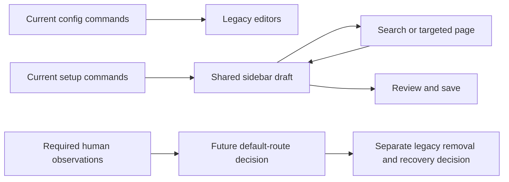

# Configuration retirement automated review

Local validation and QA preparation are complete. Default command switching and legacy-window removal remain pending because the required human observations have not been supplied. Profile2 remains unchanged. No in-game acceptance, provider output or restart activation is claimed.

## What changed in this checkpoint

The restart capture adapter now explicitly selects its intended finish page. It no longer relies on a save result moving the live editor away from the user's page. Runtime navigation is unchanged.

The regression run exposed old fixture assumptions. Tests now accept the expanded scene catalog without a brittle count, read keyed rich-text status messages, expect the approved Old settings label, distinguish description chat/diagrams from native record previews, and use capture-only sessions for navigation-only checks. The long-form geometry test verifies each clip rectangle, offscreen pointer rejection and per-control scroll reachability before applying canvas/footer bounds checks. Ordinary-session save tests retain their save callback and draft-preservation checks.

## Automated results

| Run | Passed | Failed | Skipped | Total |
|---|---:|---:|---:|---:|
| Full native regression before fixture repairs, 20m 11s | 2,112 | 15 | 0 | 2,127 |
| Combined focused repair/capture retest, 5m 49s | 85 | 4 | 0 | 89 |
| Final remaining-method retest, 1m 55s | 4 | 0 | 0 | 4 |

Every original failed case has a subsequent passing focused result. The intermediate four failures came from an incorrect test correction that conflated records with diagrams and a capture-only footer expectation. Both were corrected without product behavior changes. Counts overlap and must not be added together. The full suite was run once; it was not repeated after the capture-adapter and fixture-only repairs.

The canonical local build/package completed with 0 errors and 368 analyzer warnings. Agent tooling had already passed and was not rerun because this checkpoint changed no tooling.

## Preview evidence

There are 248 current PNG/manifest pairs at 1280 by 720, across scales 1 and 1.25:

- 222 standalone captures cover all 111 current wizard scenes, including the wording and formatting-shortcut scenes.
- 14 native search captures cover empty/no-result/results/scrolled results and scalar/language/sheet targets.
- 12 native action captures cover maintenance, new settings, confirmation, failed/partial reload and restart details.

The aggregate index asserts each image and manifest exists, every source stamp is nonnull and current, and every capture has a mod assembly identity. It preserves the individual coverage labels: 222 `standalone-gui-and-seraph` and 26 `standalone production GUI, no game or persistence acceptance`. These labels do not establish native GPU parity or human acceptance.

Representative action/search captures and the longest wording, shortcut and TTS forms were inspected at both scales. Clip boundaries keep scrolled content separate from the status/footer. Actual keyboard use, audibility, provider output, persistence and activation remain human QA work.

## Decisions still pending

Current `/tb config` commands, language/sheet config subcommands and direct sheet aliases retain legacy destinations. `/tb setup` and its targeted aliases use the shared sidebar draft. The Old settings escape, advanced command, failure fallback and legacy packet support remain available.

All [human QA cards](2026-10-28-config-retirement-human-qa.md) remain pending. Staging, final restart/reconnect and explicit human QA completion require owner input. Older-client wire compatibility is a separate deferred decision. No wire contract was removed or renumbered.

Before any later approved in-game batch, verify the staged server ZIP and Profile2 ZIP both match the reviewed receipt SHA256. A matching 5.9.1 version string is insufficient. Current evidence proves only the local package and unchanged Profile2 baseline. Server/client installation is pending.

## Evidence appendix

Artifacts are in [final-20261028](C:/Users/steve/.codex/visualizations/2026/10/02/01a0fa70-8ca5-7321-ac1f-07fe824f5be2/config-retirement/final-20261028):

- [Capture index](C:/Users/steve/.codex/visualizations/2026/10/02/01a0fa70-8ca5-7321-ac1f-07fe824f5be2/config-retirement/final-20261028/capture-index.json), with all current per-image provenance.
- [Package receipt](C:/Users/steve/.codex/visualizations/2026/10/02/01a0fa70-8ca5-7321-ac1f-07fe824f5be2/config-retirement/final-20261028/package-receipt.json), [verification](C:/Users/steve/.codex/visualizations/2026/10/02/01a0fa70-8ca5-7321-ac1f-07fe824f5be2/config-retirement/final-20261028/package-verification.json), and [archived ZIP](C:/Users/steve/.codex/visualizations/2026/10/02/01a0fa70-8ca5-7321-ac1f-07fe824f5be2/config-retirement/final-20261028/package/thebasics_5_9_1.zip).
- `full-regression.log`, `focused-retest.log`, `final-retest.log`, corresponding TRX files in `test-results`, `wizard-all.log` and `build-package.log` preserve exact results. Original full-run captures outside `captures/` retain their earlier stamp and are excluded from the final index.
- `profile2-verification.json` records both unchanged baseline files. No live server was queried.

| Identity | SHA256 |
|---|---|
| Final GUI source | `0408951d25c0e147156d345957ca8940e15bd1f2a577344384c62a9ed850d8b3` |
| Capture Debug assembly | `a5eaad210aed2ac510c9c9b0af3656f4a348adc83ed9f02acfdb3e4c4f3e7682` |
| Packaged Release assembly | `b462a7961a0c794f1fab9eb612a6cb3d347e005fc4378512b714fd64f1870a70` |
| Archived 5.9.1 ZIP | `1a714be02c547aacb4c8b61dfa2da78165bef489031372c6967be193b4c41730` |

Only this checkpoint's exact approved docs and fixture/test files are committed. Existing unrelated dirty/untracked work is preserved. The [dated handoff](../agent-context/2026-10-28-config-retirement-qa.md) identifies the remaining work and retirement condition.
