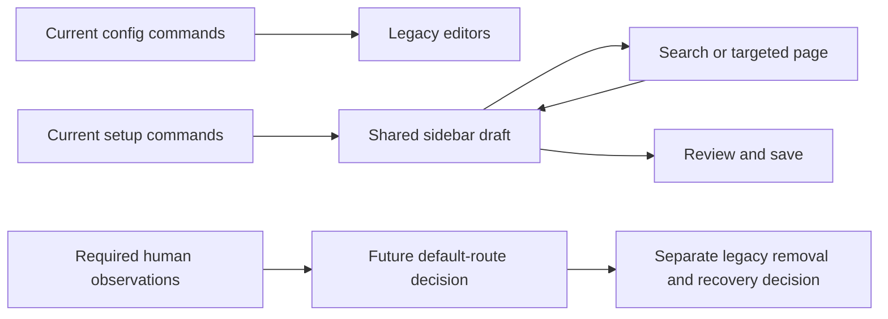

# Configuration retirement automated review

All five final-review findings have local fixes and focused regression coverage. The scoped re-review passed for specification and quality, with all five findings addressed and no new actionable issues. The revised package and standalone captures are ready for an approved human QA batch. Default command switching, legacy-window removal and human acceptance remain pending. Profile2 remains unchanged; no game, provider or restart acceptance is claimed.

The [final source review](C:/Users/steve/.codex/visualizations/2026/10/02/01a0fa70-8ca5-7321-ac1f-07fe824f5be2/config-retirement/final-reviewed-20261028/reviews/final-rereview.md) covers the combined fix at source commit `bb246fd995408c009b8fcaeca1d50a3ed8c28858`. Later handoff bookkeeping does not change the packaged source.

## Final-review corrections

The editor now uses the accepted server values to decide which settings are available. Missing generic, wording and shortcut controls explain their availability without creating editable defaults. Supported edits remain in the shared draft and save patch. Search omits missing settings and uses loaded values. Map/stat refresh and the combined announcement selector handle missing controls safely. Related previews explain missing settings instead of rendering defaults.

Search displays the same friendly labels as the editor, including Talk, while retaining exact `.Normal` key searches and previous registry labels as aliases. An open privilege suggestion menu consumes the first Escape; the next returns to the preserved search. The prose input example is now field help rather than fake chat history. TTS falloff help describes fading with distance and retains the provider/readiness qualifications.

The eight categories, one draft, Review, atomic Save, raw configuration values, permissions and existing wire numbers remain intact. No default routes or legacy windows changed.

## Automated results

| Run | Passed | Failed | Skipped | Total |
|---|---:|---:|---:|---:|
| Original full native regression, 20m 11s | 2,112 | 15 | 0 | 2,127 |
| Original focused repair/capture retest, 5m 49s | 85 | 4 | 0 | 89 |
| Original remaining-method retest, 1m 55s | 4 | 0 | 0 | 4 |
| Corrected final-fix red fixtures, before source changes | 2 | 12 | 0 | 14 |
| First fix run, before retaining old search aliases | 27 | 1 | 0 | 28 |
| Broader final-fix regression, 2m 13s | 62 | 0 | 0 | 62 |
| Layout/dependent-preview correction, 1m 13s | 46 | 0 | 0 | 46 |
| Frozen source after final copy/label pass, 1m 12s | 18 | 0 | 0 | 18 |

Counts overlap and must not be added. Every failure from the original full run has a later passing focused result, but the full suite was not repeated. The original intermediate four failures were fixture corrections, not a fresh full-green run. The first final-fix attempt also lacked language initialization in the new search fixtures (0 passed/14 failed); its log is retained separately and is not treated as product-only red evidence.

The 62-case sweep includes all 210 scalar search destinations and search entry from every page. The later 46 cases cover the final behavior; the last 18 recompile and exercise the frozen copy/label source with native search/action/fix captures. A deliberately partial snapshot verifies generic and specialized controls, dependent refresh, search, preserved supported edits, save originals and omission of unavailable patch keys. The popup test verifies both Escapes, destination, query and draft retention.

The canonical local build/package completed with 370 warnings and no errors. No tooling files changed, so the already passing agent-tooling check was not repeated.

## Current standalone evidence

The current index contains 256 PNG/manifest pairs at 1280 by 720, across scales 1 and 1.25:

- 222 captures cover all 111 current wizard scenes.
- 14 native search captures cover empty/no-result/results/scrolled results and scalar/language/sheet targets.
- 12 native action captures cover maintenance, new settings, confirmation, failed/partial reload and restart details.
- Eight native final-fix captures show unavailable Diagnostics/wording fields and the privilege popup before/after Escape.

The aggregate verifies each image and receipt, the final frozen source stamp, matching mod assembly identity, coverage label and per-set counts. It retains the distinction between 222 `standalone-gui-and-seraph` and 34 `standalone production GUI, no game or persistence acceptance` captures. Source stamps are also checked against compiled assembly metadata. These checks do not prove native GPU parity or human acceptance.

Changed and compact renders were inspected, including unavailable controls, popup states, wording, shortcuts and TTS. An intermediate Diagnostics overlap was corrected before the frozen-source pass. No further source edits occurred during that final capture/package pass.

## Decisions still pending

Current `/tb config` commands, language/sheet config subcommands and direct sheet aliases retain legacy destinations. `/tb setup` and its targeted aliases use the shared sidebar draft. The Old settings escape, advanced command, failure fallback and legacy packets remain available.

All [human QA cards](2026-10-28-config-retirement-human-qa.md) remain pending. Staging, actual keyboard/GPU behavior, audibility, provider output, permissions/persistence and restart/reconnect activation require their own evidence and approval. Older-client wire compatibility is a separate deferred decision. No wire contract was removed or renumbered.

Before any later approved in-game batch, verify the server and Profile2 ZIPs both match the reviewed receipt SHA256. A matching 5.9.1 version string is insufficient. Current evidence proves only the local package and unchanged Profile2 baseline.

## Evidence appendix

Current artifacts: [final-reviewed-20261028](C:/Users/steve/.codex/visualizations/2026/10/02/01a0fa70-8ca5-7321-ac1f-07fe824f5be2/config-retirement/final-reviewed-20261028).

- [Capture index](C:/Users/steve/.codex/visualizations/2026/10/02/01a0fa70-8ca5-7321-ac1f-07fe824f5be2/config-retirement/final-reviewed-20261028/capture-index.json).
- [Package receipt](C:/Users/steve/.codex/visualizations/2026/10/02/01a0fa70-8ca5-7321-ac1f-07fe824f5be2/config-retirement/final-reviewed-20261028/package-receipt.json), [verification](C:/Users/steve/.codex/visualizations/2026/10/02/01a0fa70-8ca5-7321-ac1f-07fe824f5be2/config-retirement/final-reviewed-20261028/package-verification.json) and [archived ZIP](C:/Users/steve/.codex/visualizations/2026/10/02/01a0fa70-8ca5-7321-ac1f-07fe824f5be2/config-retirement/final-reviewed-20261028/package/thebasics_5_9_1.zip).
- `red-fixture-init.log`, `red-regression.log`, `intermediate-alias-regression.log`, `focused-regression.log`, `final-focused.log`, `frozen-source-captures.log`, corresponding TRX files, `wizard-all.log` and `build-package.log` preserve the sequence. Intermediate source hashes are retained separately; only the final frozen source appears in the current index.
- `profile2-verification.json` records both unchanged baseline files. No live server was queried.

| Current identity | SHA256 |
|---|---|
| Final frozen GUI source | `db9b403d7d5b46031b8661a80eaa32e14da2f6be497025bff177042f9b6a288a` |
| Capture Debug assembly | `9ebf56cc29a9bcc4941fa2979a6e098c071c7eb58184534d7820db6efc93a18d` |
| Packaged Release assembly | `914461a4267c59da9794b8656cbb038205e4101c498136764de62c1e854cc646` |
| Archived 5.9.1 ZIP | `647e2b5fedbb732e98422ed8c5da12d0cd9a68f301f1a8345a9b0a32d678f48e` |

The previous [final-20261028 artifacts](C:/Users/steve/.codex/visualizations/2026/10/02/01a0fa70-8ca5-7321-ac1f-07fe824f5be2/config-retirement/final-20261028) remain untouched as history, including the initial full-run and repair evidence. That earlier source was `0408951d25c0e147156d345957ca8940e15bd1f2a577344384c62a9ed850d8b3`; its archived ZIP was `1a714be02c547aacb4c8b61dfa2da78165bef489031372c6967be193b4c41730`. It is not the revised package.

The exact owned commit preserves unrelated dirty/untracked work. The local package includes those previously approved baseline dependencies; a clean checkout of this commit alone is not claimed to reconstruct the entire workspace. The [dated handoff](../agent-context/2026-10-28-config-retirement-qa.md) identifies the remaining work and retirement condition.
