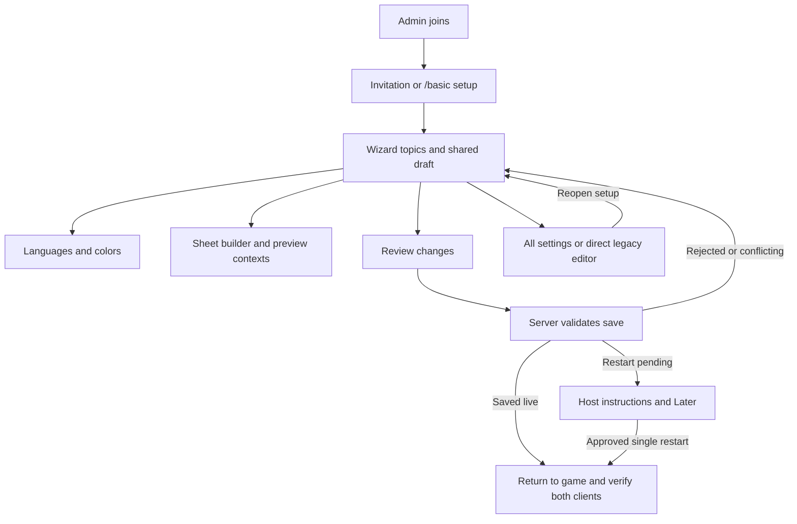

# Visual settings human QA plan

Status: **Owner authorized human QA on October 28. Environment preparation is in progress. No cards passed. QA client launches are authorized.**

This plan checks the accumulated visual settings wizard in a real game, with particular attention to preserving character-sheet answers and rejecting unsafe saves. It covers configured languages, shared colors, the sheet-first builder, older editors, scene colors and switches, permissions, invitation and restart guidance. Standalone captures and automated tests are separate evidence; they do not pass these cards.

Run draft-only checks first, then one live-settings batch on disposable data. Reserve one server restart for the final activation card. The owner authorized preparation and starting QA in chat; completion still requires explicit owner approval. Results and artifact identities belong in the run record.

## Preparation after approval

Use a disposable world with a restorable snapshot. Record original settings, language definitions, sheet template and marker defaults before changing them. Verify that the server and both clients have the intended package and a clean startup before requesting human observations. Keep the primary client an administrator with `root`; keep a second client a normal player without `root`. Do not grant the second client administrator access for convenience.

Prepare two ordinary unbound sheet fields on the second player's real sheet with recognizable test answers, for example `QA retained answer A` and `QA retained answer B`. Record their existing IDs privately. Use disposable marker text and language definitions. Do not copy personal answers or server identifiers into reports. Record answer presence and equality, rather than whole stored sheets. Any operator setup needed below must use an existing verified administration route, not guessed commands.

Run the layout-sensitive cards at the normal viewport and at 1280x720 with GUI scales 1 and 1.25. Include the legacy language editor, legacy field editor and scene-marker editor at both compact scales. Their controls, help, errors, pickers and footer must fit and remain usable. Treat clipping as a failed card; do not shrink text to hide it.

## Journey under test

## Batch A: current server configuration, local drafts only

No saves or restarts in cards 1-11. Discard the draft between unrelated cards unless a card explicitly tests navigation retention.

1. **Invitation, access and reopening** (P0)
   - Config: an administrator whose invitation has not been acknowledged in this disposable world; normal second client.
   - Do: join with both clients. Finish any character-creation or consent dialog first. On the administrator, dismiss the invitation intentionally, inspect chat, then enter `/basic setup`. On the normal client, try `/basic setup` and `/basic config`.
   - Expect: the invitation waits for other interactive dialogs. Dismissal gives one reminder containing `/basic setup`. That command opens current settings for the administrator. The normal client gets no invitation or configuration editor.
   - Watch for: duplicate prompts, config disclosure, blocked character creation, or a disconnect being recorded as an intentional decline. Reconnect persistence is checked in card 18; do not reset acknowledgement on an existing world to manufacture this card.

2. **Navigation, guide and unsaved close** (P1)
   - Config: any.
   - Do: visit every category, scroll Teleportation's pages, and use keyboard focus plus Enter/Space to select a sidebar item. Change a scalar, a language description and a sheet label. Visit Review, return to each page, then Escape and cancel discard. On Topics, drag and flick Pip, begin a new drag, then navigate away. Finally discard and reopen.
   - Expect: all category headers and the footer remain reachable. Edits and category positions survive navigation and canceled close; Review lists all three changes. A new session after discard has the original values. Pip animates, stays clipped and stops responding to a canceled drag. The real player's inventory and appearance remain unchanged.
   - Watch for: lost caret/focus, scrolling a setting by accident, hidden footer, stale dirty indicators or stuck drag input.

3. **Chat scenes and disabled help** (P1)
   - Config: draft only.
   - Do: compare all four speech presentations, separate channels versus General replacement, and roleplay features Off/On. Inspect Languages and OOC, hearing distance and obfuscation. On Map visibility, turn management Off and attempt mouse, keyboard and text edits on its dependent controls; hover their help. Re-enable it, hide other players, and inspect the range control.
   - Expect: each page shows its relevant chat or hearing example. General replacement removes the sample Proximity tab. RP Off retains nearby chat and explains unavailable RP features. Disabled controls retain their values and cannot change; their explanation is still accessible. Map management Off shows an unmanaged sample and hiding players disables the range. Preview chat input sends nothing to real chat.
   - Watch for: disabled values changing through focus, missing help, fabricated chat messages explaining gates, or examples claiming a range boundary includes the endpoint.

4. **Travel, announcements and other topic examples** (P1)
   - Config: draft only.
   - Do: turn homes Off while leaving spawn On and inspect the shared gear choice. Toggle request cooldown/timeout. Compare independent save-start/save-finish Off, Chat and Chat notification choices with custom wording. Set sleep percentage to 50, 0 and 100. Visit overhead speech, typing, names, dice, history, notes, stats and character slots and change one visible choice on each.
   - Expect: spawn's cost remains available. Disabled tools retain their settings. Notification history and beige notification styling match the selected mode, without a fake popup. The four-bed example triggers at two sleepers for 50% and never at 0% or 100%. Other examples follow their own controls; no draft preview sends chat, plays a real dice roll, writes notes or swaps the player's character.
   - Watch for: linked start/finish modes, misleading timing units, overlapping labels or unrelated pictures. This card checks examples, not every underlying gameplay subsystem.

5. **Configured languages and shared review** (P1)
   - Config: draft only; keep at least one default language.
   - Do: in Chat > Languages, select an actual configured entry. Edit its name, chat code, description, unfamiliar sounds, color, default/hidden switches and one grant list under Who starts with it. Add a disposable language, reorder it and remove it again. Navigate away and back, then inspect Review.
   - Expect: selected names and understood/unfamiliar examples follow the draft. Grant fields preserve exact entered IDs. Review names the net changes; removed temporary edits do not appear as saved additions. Changes remain part of the wizard draft.
   - Watch for: editing the wrong entry after reorder, raw markup being interpreted as UI, lost flags, unexpected language grants or a separate save occurring on page navigation.

6. **Language validation and color picker** (P0)
   - Config: draft only.
   - Do: temporarily duplicate a language's chat code and remove the last default-language flag. Try invalid RGB text. Inspect the error and disabled save state, then correct each value. Open a palette, choose a swatch, expand Custom spectrum, edit RGB, use Original and close with Escape. Try keyboard selection and scroll while the palette is open.
   - Expect: invalid drafts remain editable, show readable errors and cannot save. Correction clears the errors. Picker, typed text and examples agree. Original restores the opening value without a false change. Escape closes the picker before the parent dialog; no click leaks to a control behind it.
   - Watch for: transparent language colors being accepted, stale error state, lost draft text or an off-screen picker at the supported sizes.

7. **Chat and nametag color contracts** (P1)
   - Config: draft only.
   - Do: on Chat colors, type a named color, choose a palette value and a custom spectrum value. On Nametag colors, try a translucent color and then the empty game-theme value. Restore the original values. Repeat representative choices in `/basic config` after discarding the wizard draft.
   - Expect: the input, color chip and relevant preview agree. Named chat colors remain usable; nametag alpha and empty theme choice remain available. Restoring the original clears that change. Advanced-editor chips open beside the intended scrolled control rather than outside its viewport.
   - Watch for: forced conversion losing alpha or names, different contracts in the two menus, stale preview tint or a popup selecting a different setting.

8. **Sheet selection, keyboard and compact inspector** (P1)
   - Config: draft only; existing template with enough fields to scroll.
   - Do: open Characters > Sheet builder. Click a field's label and answer area. Select another field by keyboard. Edit its label in the middle of the text; scroll the sheet and inspector independently. Navigate away and return. At compact width, enter the inspector and use Back to sheet.
   - Expect: selection outlines the whole field and opens its properties; keyboard focus is visibly distinct. Answer clicks never edit Pip's sample answer. Typing keeps the caret. Selection and scroll positions survive updates and the returning inspector. Text stays readable and footer controls remain reachable.
   - Watch for: answer-save requests, a second competing field list, clipped selection targets, focus moving on each keystroke or a reset scroll position.

9. **Sheet types, layout and validation** (P0)
   - Config: draft only.
   - Do: add one field of each offered type. Leave one label incomplete, then correct it. For Choice, enter duplicate and empty choices and correct them. Change type away and back. Try invalid character-limit/text-box-height text, then valid values. In Layout, pair two half-width body fields, move them up/down and place one beside the portrait. Inspect More options and copy its read-only field ID.
   - Expect: new fields start optional/public in the main sheet with stable fresh IDs. Invalid entries show errors and block save while the last valid preview remains identified. Temporary type changes retain draft choices. Reordering preserves other fields and selection. Portrait placement disables width without losing its stored choice; IDs cannot be edited.
   - Watch for: an invalid draft drawn as an accepted template, lost choice text, ID changes on label edit, unreachable validation messages or reorder across the wrong section.

10. **Sheet visibility, required state and disabled sheets** (P0)
    - Config: draft only.
    - Do: assign disposable fields Everyone, Nearby inspection, Player and staff, and Staff only. Compare Player, Other player, Nearby inspection and Staff with Example answers On/Off. Toggle Show when inspecting nearby where permitted. Select a hidden field through Browse fields and use Show staff view. Toggle Required and the required-fields roleplay gate; then turn Character sheets Off and revisit the builder.
    - Expect: Player omits staff-only; Other player shows public fields; Nearby inspection shows eligible public/nearby fields with its toggle, hiding empty optional examples; Staff shows all. Hidden selection stays editable without a ghost player-visible field. Self/staff fields disable the nearby toggle and explain it. Required warnings reflect the RP gate and player-editable fields. Disabling sheets leaves template editing available without auto-enabling them.
    - Watch for: staff-only samples leaking into a player context, required staff-only fields described as blocking player roleplay, discarded disabled values or preview changes to real answers.

11. **Legacy editors, search and separate drafts** (P1)
    - Config: no saves; retain a recognizable scalar wizard edit.
    - Do: use All settings, search for a language and a sheet field, open their results, then return. Also open `/basic config languages` and `/basic config charsheetfields`. Exercise their On/Off switches with mouse and keyboard, including a disabled control and its help where available. Close without saving and reopen `/basic setup`.
    - Expect: search reaches the intended field and preserves the advanced draft/query on roundtrips. The direct editors still work and retain their own existing save path. Both legacy editors fit at 1280x720 at scales 1 and 1.25, including their controls and footer. Closing them does not silently save, merge or discard the suspended wizard draft. The wizard edit remains.
    - Watch for: real character answers appearing in search, wrong focused result, inaccessible switches, or a legacy editor overwriting a separate draft merely by opening.

## Batch B: reviewed live changes on disposable data

Keep the baseline configuration live. No restart is expected for cards 12-17. Stop on data loss or unauthorized access. Restore changed scalar settings, language definitions, template and marker defaults after observations. Preserve the original snapshot until the owner accepts the results.

12. **Scene custom colors, Original and world save** (P1)
    - Config: markers enabled; editable disposable marker and a second marker with a different custom RGB.
    - Do: open the marker's normal editor. Compare its five presets with Custom, choose `#12ABCD`, inspect the symbol catalog, then use Original. Choose Custom again and cancel/discard; reopen. Finally save the custom color and inspect both markers from both clients. Pick up and re-place the disposable marker using the world's normal supported interaction. If testing Set defaults, record and restore the opening defaults.
    - Expect: preset selection clears Custom. Original restores both opening RGB and preset/custom selection. Cancel leaves the world unchanged. Save, reopen and re-placement retain the custom RGB; both clients see the same tint. Differently colored icons remain distinct. A newly created marker uses explicitly saved defaults only after Set defaults.
    - Watch for: the wrong icon tint after visiting the catalog, custom color disappearing on pickup, a false dirty prompt after Original or preview changes appearing in the world before Save.

13. **Scene switches, locks and feature disablement** (P0)
    - Config: disposable marker with saved text; primary can manage its lock.
    - Do: change bobbing, show-body and unlimited-distance switches, inspecting their dependent distance inputs. Save/reopen. Lock the marker and try editing with both clients. As administrator, turn Scene markers Off through setup, save and inspect the existing marker; then turn it back On.
    - Expect: saved switches reopen correctly; unlimited distance disables the corresponding numeric input without losing its value. Locked controls, picker and save/default actions cannot change data. Turning the feature Off blocks crafting, placement and editing while retaining the existing marker and text. Re-enabling reveals retained content.
    - Watch for: keyboard bypass of disabled controls, a locked marker accepting custom RGB, missing-block replacement or content loss. Do not destroy a retained marker to prove disablement.

14. **Atomic save and retained real sheet answers** (P0)
    - Config: baseline real answers prepared above; no binding or type changes yet.
    - Do: change only the two existing fields' labels, order and widths. Add one optional field. Also change a harmless scalar and a disposable language description. Inspect old/new Review rows, save once, wait for acknowledgement and reopen setup. On the second client open `/charsheet` and inspect its real answers. Compare the two stored test answers read-only against the baseline.
    - Expect: all reviewed changes persist together after server acknowledgement. Existing field IDs and real answers are unchanged. The new field has no Pip sample/default answer. Both clients receive the updated template. No success page appears before acknowledgement.
    - Watch for: template-only save dropping scalar/language edits, altered answer bytes, a sample written into a player's sheet or old definitions still shown on the second client.

15. **Consequential template edits and fresh IDs** (P0)
    - Config: disposable fields and answers only; restorable template snapshot.
    - Do: inspect Review warnings for a type, choice-list, tighter-length and Use as binding change, one at a time. Save controlled changes and compare stored answers read-only. Remove the second answered field, confirm and save. Start a later setup session and add the same label again; compare its read-only ID with the recorded removed ID and view the real sheet.
    - Expect: warnings say existing answers remain and may need updating; binding warnings explain the changed source. Saving does not convert or erase stored answers. Removal hides the old answer while retaining its stored value. The recreated label has a fresh ID and does not display the old answer. Required-state warnings describe the actual gate, without promising full migration or revalidation.
    - Watch for: old answers attaching to the new field, IDs derived from labels, data purges, silent conversion or review warnings based on an intermediate edit that was reverted.

16. **Server-side permission rejection and recovery** (P0)
    - Config: normal second client without root; a separate approved operator route available for temporary primary permission changes.
    - Do: repeat denied open attempts for `/basic setup`, `/basic config languages` and `/basic config charsheetfields` as the normal player. For save-time enforcement, prepare a primary wizard draft, have the operator temporarily remove its root permission without changing other data, then attempt Save. Restore permission through that same verified route and recover/retry the draft.
    - Expect: the normal client receives no config snapshot/editor. The server rejects the now-unauthorized save and persisted scalar/language/template values remain unchanged. The draft stays available with an error; restoring permission permits deliberate recovery without claiming the rejected save succeeded.
    - Watch for: client-side-only permission checks, config disclosure, partial writes, discarded edits or a success screen on denial. If no independent recovery route exists, leave save-time revocation pending rather than risk locking out the test administrator.

17. **Conflict rejects the whole save and preserves unrelated edits** (P0)
    - Config: root restored; wizard draft with one scalar, language and sheet change.
    - Do: keep that draft, open `/basic config charsheetfields` as a separate session and save a different valid template change. Reopen the suspended wizard and attempt its stale save. Inspect the error and both drafts. At 1280x720 at scales 1 and 1.25, open Languages while the server save error is visible, temporarily enter a duplicate chat code, and inspect the validation error, server status and footer together. Correct the code. In Browse fields choose Discard field edits, first cancel, then confirm loading the latest server template. Verify scalar/language edits remain and deliberately retry. Repeat the stale-language case through `/basic config languages` if it has not already been covered by a live recovery observation.
    - Expect: conflict rejects all submitted changes, including the scalar and language. Local edits survive. Compact language validation and server-save-error text remain readable without overlapping each other, controls or the footer. Cancel leaves field edits intact; confirmed reset adopts current fields only and preserves unrelated changes. The retry persists exactly the reviewed draft. Reset and duplicate Save stay unavailable while a request is pending or its outcome is unknown.
    - Watch for: partial commits, resetting all draft categories, silent overwrite of the legacy save or a repeated request while an earlier save may still complete. Use read-only authoritative comparisons for rejection; a friendly error alone is insufficient.

## Batch C: one approved restart and reconnect

18. **Restart guidance, activation and invitation persistence** (P0)
    - Config: original startup values recorded; choose one restart-shaped setting, such as Use General as proximity chat. Review any remaining pending restart keys before scheduling this batch.
    - Do: save the selected change and choose Later. Reopen setup and inspect persisted values and pending restart guidance. Before restarting, save the original startup value again and confirm that its pending key clears. Then save the intended test value once more. Read How to restart for the actual host. Only after explicit approval, perform one restart and reconnect both clients. Check the intended chat tab layout and ordinary near/far delivery. Check that the acknowledged invitation does not return. Restore the baseline through the agreed cleanup plan; do not add an unapproved second restart.
    - Expect: Review marks the setting After restart. Later returns to the game without stopping anything. Saving reports configuration persistence separately from activation; reverting to startup clears the key. Dedicated-host instructions explain an external restart and reconnect; an integrated world uses save-and-quit/reopen instructions. After restart, both clients show the intended tab layout and delivery. An acknowledged invitation stays dismissed.
    - Watch for: a shutdown labeled Restart now, automatic restart on Save, a stale pending key, config mutation claimed as activation proof, duplicate tabs or repeat invitation. Record any baseline activation still awaiting a cleanup restart.

## Optional bounded edge cases

- **Unknown save result:** only with a pre-approved bounded response-delay/failure fixture. Verify that edits made after submission survive acknowledgement, timeout does not imply failure, and authoritative recovery happens before reset/retry. Do not interrupt a shared service or invent a packet command to force this.
- **Persistence failure:** use an existing disposable failure fixture if available. Confirm no partial scalar/language/template write and retained draft. A server rejection test does not prove disk-write failure handling.
- **Language behavior:** with one test-only nondefault language, verify known/unfamiliar speech and hidden/default/grant behavior on the second client, including rename reconciliation. Do not change existing players' grants merely for a preview check.
- **Additional host:** run the restart wording card on the other host type if available. A dedicated-host pass does not establish integrated-world behavior.
- **Rendering stress:** repeat picker open/close, wizard close/reopen and scene-color switching several times, inspect logs for new exceptions and watch for missing meshes, stale colors or stuck input. Repeat the legacy language, legacy field and scene-marker editors at 1280x720 at scales 1 and 1.25; clipping or unreachable controls fail this check.

## Evidence and completion

Report card number, viewport/GUI scale where relevant, action and observation. A useful report is: `Card 8, scale 1.25: selected the lower field, edited its label, returned from the compact inspector, and the same field and scroll position remained selected.` Include a screenshot for clipping or color mismatch and the exact visible error for rejection/conflict. For cards 14-17, report which settings/answer comparisons stayed equal and which intentional changes persisted. Do not paste private answers or full config payloads.

Simple binary checks can use a batch confirmation. Complex rendering, retention, permission, timing and recovery cards require the owner's concrete observations. The agent records Passed, Failed, Pending or Deferred per card; source inspection, a screenshot fixture or silence cannot mark a card passed. P0 failures stop the affected batch. Re-test a fixed card and any shared behavior it could affect, without repeating unrelated passed cards or adding needless restarts.

Triage discoveries after each batch. Contributor-facing GitHub actions still require owner approval. Final QA completion requires the owner's explicit approval and a recorded cleanup state. Until then, every card in this plan remains pending.

## Source references

- [Wizard design](../superpowers/specs/2026-10-01-visual-config-wizard-design.md), [configured languages](../superpowers/plans/2026-10-19-configured-language-editor.md), [shared colors](../superpowers/plans/2026-10-20-shared-color-settings.md).
- [Sheet builder design](../superpowers/specs/2026-10-26-character-sheet-builder-design.md), [sheet builder plan](../superpowers/plans/2026-10-26-character-sheet-builder.md), [scene custom colors](../superpowers/plans/2026-10-25-scene-marker-custom-colors.md).
- Command names checked against `RPProximityChatSystem.RegisterAdminConfigCommands` and `CharacterSheetSystem.RegisterCommands`. Current source uses **Browse fields**, **More options** and **Discard field edits**, where older design sketches use All fields, Advanced and Reload sheet fields.
- Runtime behavior and controls checked against `SetupWizardCatalog`, `SetupWizardDialog`, `SetupWizardLanguageEditor`, `SetupWizardSheetEditor`, `SceneDescriptionDialog` and `SceneDescriptionSystem`. The human-QA workflow is [.opencode/skills/human-qa/SKILL.md](../../.opencode/skills/human-qa/SKILL.md).
