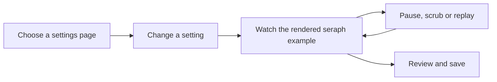

# Rendered seraph previews implementation plan

**Goal:** Replace every drawn character in the wizard with a clothed seraph rendered from game assets, including standalone captures. Keep VS launches paused.

**Architecture:** Use the existing detached native seraph renderer in-game. The standalone backend loads the same appearance and outfit fixtures, composes the real game shapes and textures, and uses the game's tessellator and animator before rendering textured triangles. Both backends implement the same small actor interface and consume the same scene placements.

**Tech stack:** Existing C#, Vintage Story shape/tessellation/animation APIs, Cairo and the existing software GUI compositor. No new package dependencies or shipped copies of game assets.

**Spec:** The owner requested actual rendered seraphs in every preview, with standalone support and no VS launches. The current sidebar, setting behavior and save flow stay as approved.

## User experience

Pip keeps the chosen skin, hairstyle and clothing. Speech scenes contain two real seraphs; teleport scenes move the rendered traveler between platforms; appearance examples place real bubbles and nametags over the model; character sheets show rendered portraits with distinct Pip and Mara appearances; sleepers use the game's lying pose. Replay, pause, scrubbing and drag rotation continue to work.

This changes the figures inside the existing settings pages. It adds no navigation or save steps.

## Scope and ownership

- [x] Native worker: define the common actor contract, reuse the detached renderer, add a real Mara outfit fixture, remove cartoon painters and wire native actors into every affected scene. Preserve pose control, rotation, disposal and input isolation.
- [x] Model worker: load native shape, skin and clothing assets through the preview host; use native shape attachment, tessellation and animation. Missing assets or unsupported operations must fail visibly.
- [x] Raster worker: render the real textured mesh with joint transforms, depth and transparency. Add independent synthetic pixel checks for those operations.
- [x] Root: implement the standalone actor adapter and asset lookup, wire its factory into all visual callers, update coverage/provenance and repeatable workflow documentation.
- [x] Root: run focused and full tests, source and visual review, generate source-stamped wide/compact renders at both scales, and present a fresh gallery.

## Checks and risks

- Preserve the existing speech, signing, travel, nameplate, typing, character-slot and note semantics. Pure setting and lifecycle tests still apply.
- Verify real skin/clothing assets and animation changes affect rendered pixels. Do not substitute a drawing or a cached screenshot when loading fails.
- Check portrait clipping, sleeping poses, transparent clothing, teleport fades, replay/scrub consistency, independent actors, focus and texture cleanup.
- Record game assets and renderer coverage in capture manifests. The standalone renderer uses the game geometry and poses but its lighting is not the live GPU shader. Native screenshot calibration and live motion performance remain separate checks while launches are paused.
- Do not launch clients, modify profiles, contact the test server, deploy or mark human QA complete.

## Verification, October 18

The local implementation and package are ready for review in the [render gallery](C:/Users/steve/.codex/visualizations/2026/10/02/01a0fa70-8ca5-7321-ac1f-07fe824f5be2/rendered-seraph-previews-20261018/gallery.md). It includes the standalone teleport clip and all 220 captures, covering 55 scenes at two scales in wide and compact windows. Source and visual reviews found no remaining concrete defect in the checked scenes. Both appearance fixtures match the packaged ZIP contents.

The full suite passed 1,653 tests. After the final sleep-camera and close-range spacing corrections, 35 focused scene and actor checks passed with no skips. The capture-report suite passed 19 tests. Agent tooling and whitespace checks passed.

VS launches stayed paused. No profiles or server files changed. Native GPU calibration, in-game framing and live animation performance remain unchecked. This work does not mark manual QA complete.

## Evidence

- [Render verification and source identity](C:/Users/steve/.codex/visualizations/2026/10/02/01a0fa70-8ca5-7321-ac1f-07fe824f5be2/rendered-seraph-previews-20261018/render-verification.json)
- [Motion verification](C:/Users/steve/.codex/visualizations/2026/10/02/01a0fa70-8ca5-7321-ac1f-07fe824f5be2/rendered-seraph-previews-20261018/motion-verification.json)
- [Local package receipt](C:/Users/steve/.codex/visualizations/2026/10/02/01a0fa70-8ca5-7321-ac1f-07fe824f5be2/rendered-seraph-previews-20261018/build-receipt.json)
- Source identity: `a7450ac312eefe1cac5f20fe521eb8443b61be8e2359d8707c39bbe360021695`.
- Local package SHA-256: `f8b5fc763598e747d27639a534117313a6c6c1b21729030461c89ec7c16c8e55`.
