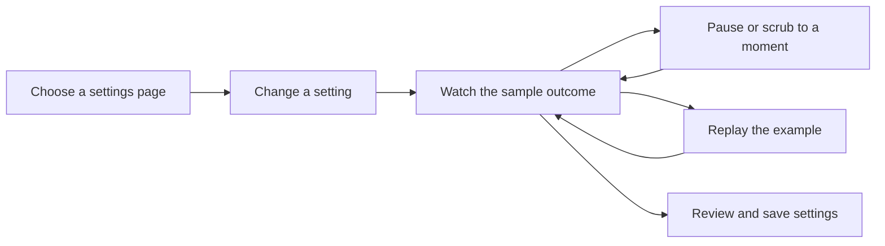

# Settings preview lifecycles implementation plan

> **For agentic workers:** Use subagent-driven development with separate file ownership. Root integrates the dialog and runs builds sequentially.

**Goal:** Implement all five approved preview ideas and shared playback controls, with standalone renders and no game launches.

**Architecture:** Reuse existing rendering helpers and native GUI widgets with local sample data. The existing preview clock drives each scene; Replay, Pause and a time slider control that clock. Capture-only time validation remains separate from the interactive timeline.

**Tech stack:** Existing C#, Cairo, Vintage Story GUI composer, GuiPreview and tests. No dependencies, configuration keys or wire fields added.

**Spec:** The five ideas approved in chat: typing/bubble lifecycle, nametag visibility, chat-tab behavior, character sheets/slots, and native notes/notebooks. Include Replay, Pause and scrubbing through long travel warmups.

## Scope and decisions

- Preserve the previous speech, signing, travel, map, scene-marker, dice and sleep work in this worktree.
- Keep VS launches, profile changes, deployment and live QA paused. Samples must not send chat, save settings, open real player records or mutate world state.
- Use production bubble/typing/nameplate styling. Standalone captures use the existing illustrated traveler where native character rendering is unavailable; live appearance previews retain interactive Pip.
- Typing timeout changes state to Thinking. Bubble expiry follows the actual effective display duration.
- Demonstrate nametag targeting, range and line of sight with a fixed scene. Show the nameplate itself instead of instructions inside the image.
- Demonstrate chat opening, a General selection, nearby speech, an incoming General message, closing and reopening. Apply the real tab rules and the local game auto-switch preference.
- Compose small read-only sheet and note panels from native widgets and production layout/style choices. Character-sheet auto-open is a server default with a player override. Slot limits do not delete existing identities.
- Keep permission codes and storage limits in their controls and help text.
- Use the existing sidebar journey. This work changes previews inside a selected settings page, not navigation or save behavior.

## Tasks and ownership

### 1. Appearance lifecycle

Owner: appearance worker. Create `SetupWizardAppearancePreview.cs` and focused tests. Minimally share existing painter/font/background helpers in `TypingIndicatorRenderer`, `SpeechBubbleVtmlPatches` and `EntityBehaviorNameTagPatches` where this avoids copying native styling.

- [x] Test typing/Thinking/closed boundaries, bubble expiry, target/range/LOS visibility, themed colors, disabled dependencies and no sample side effects.
- [x] Implement `Supports`, `Draw`, `DurationSeconds` and small pure state helpers. Use a 310 by 270 logical scene and report the actor bounds for native integration.
- [x] Preserve production behavior while sharing helpers; root reviews the runtime diff.

### 2. Character and note panels

Owner: records worker. Create `SetupWizardRecordsPreview.cs` and focused tests; replace only the corresponding fake rows in `SetupWizardFeaturePreview.cs`.

- [x] Test sheet enablement/auto-open, two sample identities, slots disabled and limits without destructive behavior, structured notes versus notebook, read-only input and no real record access.
- [x] Compose compact native widgets using the production field/list/editor structure. Expose `Supports`, `Add` and `Refresh` for root integration.

### 3. Chat focus sequence

Owner: chat worker. Create `SetupWizardChatFocusPreview.cs` and focused tests. Root owns native chat composition.

- [x] Test initial/default tab, remembered selection, incoming switches, prevention only from Proximity, General replacement and game auto-switch on/off.
- [x] Implement deterministic `At(draft, timeSeconds, autoChatOpenSelected)` with selected tab, stage, open state and sample messages. Use a ten-second sequence: open at 0, a General notification at 1, General selection at 2, nearby message at 4, close at 6, reopen at 7.

The incoming notification demonstrates automatic switching. Native chat does not auto-select messages of type `OthersMessage`, so nearby speech alone cannot demonstrate switch protection. This replaces the proposed General reply at five seconds while keeping the approved behavior demonstration.

### 4. Integration and playback

Owner: root. Edit `SetupWizardDialog.cs` and existing integration tests.

- [x] Route the new panels, refresh sample state and retain live Pip where appropriate.
- [x] Add Replay, Pause/Play and a native slider below animated previews. Keep controls above status/footer in both layouts. Scrubbing pauses at the selected moment and must support the configured long warmup.
- [x] Test replay, pause, resume, scrub boundaries, long warmup access, sidebar changes, input isolation, General-tab behavior and compact bounds.

### 5. Captures and verification

Owner: fixture worker for capture scenes/consumers; root for documentation, tests and renders.

- [x] Add deterministic captures for the new lifecycle and setting comparisons. Preserve the native collector's original 26-scene default and 32-job preflight. Mirror default times in consumers and manifests.
- [x] Run focused tests, the full suite, workflow self-tests and the agent tooling check. Fix valid independent source/visual review findings.
- [x] Generate fresh wide/compact renders at both GUI scales and save a gallery outside the worktree. Record source identity and remaining live-only checks.

## Review focus

Check exact timeout/range boundaries, empty/invalid numeric drafts, long durations, lifecycle changes after edits, slot caps below existing sample count, disabled widget focus/cursors, native helper parity, composer disposal and the absence of game/profile/network mutations. Sampled images do not establish live animation performance or human QA acceptance.

## Verification results

All five preview ideas and shared playback controls are implemented. All 1,581 tests passed with no skips. The mocked capture workflow passed 104 assertions; the agent tooling and whitespace checks passed. Independent source and visual review findings were fixed. The final fixed clock and brighter notes were checked in wide and compact captures.

Generated 220 renders across 55 scenes, two GUI scales and two viewport sizes. Every manifest matches source tree identity `53ce055d3b95ea1af180c396298a66c7807f63d5e580898b57ad6a6dbd630464`.

The [render gallery](C:/Users/steve/.codex/visualizations/2026/10/02/01a0fa70-8ca5-7321-ac1f-07fe824f5be2/settings-preview-lifecycles-20261016/gallery.md) includes comparisons, all captures, manifests and test logs. The [repeatable capture workflow](../../../.opencode/skills/vintage-story-agent-control/references/client-workflow.md) documents the new fixtures, playback and capture limits.

No game clients were launched, profiles changed or deployment performed. In-game Pip rendering, motion performance and input behavior still require client verification. The bubble sample uses one styled span because mixed italic/plain runs overlap in the shared rich-text renderer at fractional GUI scales; fixing that renderer is outside this preview change.
