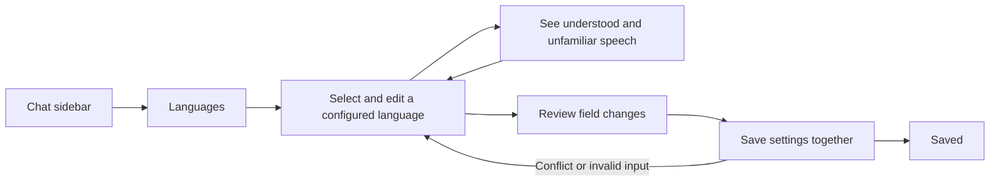

# Configured languages and boolean controls

Build the approved language editor inside the existing Chat sidebar. Administrators edit the server's actual language definitions and see understood and unfamiliar speech while typing. Language changes join the existing review and save flow. VS launches remain paused.

## Confirmed scope

- Edit names, descriptions, chat codes, colors, unfamiliar syllables, default/hidden flags and the existing class, trait and model grants. Add, remove and reorder language definitions.
- Reuse existing language validation, scrambling, chat formatting and rename reconciliation. Keep edits after failed saves or newer input during an in-flight save.
- Submit language and scalar edits atomically using appended fields on the existing setup packets. Reject stale language snapshots and invalid or excessive payloads.
- Replace boolean dropdowns in the wizard and older language/character field editors with a styled On/Off switch. Preserve disabled and keyboard behavior. Advanced settings already use native switches.
- Render the production editor with configured fixture languages at both existing GUI scales and viewport sizes. Capture invalid drafts and grant editing. Keep capture inputs local and read-only.

## Verification

- [x] Check snapshot isolation, pending-save edits, stale saves, invalid drafts, rename reconciliation and failed persistence.
- [x] Check switches with mouse, keyboard, focus, disabled states and actual saved flag values.
- [x] Review wide and compact standalone captures, including custom language colors and syllables.
- [x] Run focused tests, full suite, workflow checks and local-only packaging. Save a source-stamped gallery.

Native GPU appearance, live interaction performance and server delivery remain outside this pass while VS launches are paused. No new runtime dependency, server configuration key or standalone save path is needed.

## Results

The [standalone gallery](C:/Users/steve/.codex/visualizations/2026/10/02/01a0fa70-8ca5-7321-ac1f-07fe824f5be2/language-editor-previews-20261019/gallery.md) contains 236 captures across 59 scenes, two GUI scales and two window sizes. Configured-language scenes use custom Dock Cant and Quayside definitions supplied through the actual snapshot/draft path. They do not claim to capture a live server configuration.

The full regression suite passed 1,733 tests. After the final pending-save Reset guard, 64 focused language, toggle and recovery checks passed. The mocked capture workflow passed 108 assertions, screenshot-report tests passed 19, and workflow tests passed 2. Agent tooling, whitespace checks and local-only packaging passed.

Source and visual reviews found no remaining concrete defect in the checked paths. Timeout recovery reads the authoritative server state before allowing another save, preserves newer edits and correctly rebases acknowledged renames. Ordinary conflicts can be resolved using Reset edits, which adopts the latest snapshot without discarding other settings. Reset is unavailable while a save is pending or its result is unknown.

No VS clients launched, profile files changed, server operations ran or deployment occurred. Manual QA remains incomplete.

## Evidence

- [Capture verification](C:/Users/steve/.codex/visualizations/2026/10/02/01a0fa70-8ca5-7321-ac1f-07fe824f5be2/language-editor-previews-20261019/verification.json)
- [Local package receipt](C:/Users/steve/.codex/visualizations/2026/10/02/01a0fa70-8ca5-7321-ac1f-07fe824f5be2/language-editor-previews-20261019/build-receipt.json)
- Source identity: `869c0047c0a937eb1aa5cb9d9dd8f4da74a260db9433daf6578b9782186429c9`.
- Local package SHA-256: `dff7355392d8bb9e02aae6bea8da6fc7c9940725ea9dedeb9174219c2105bea8`.
