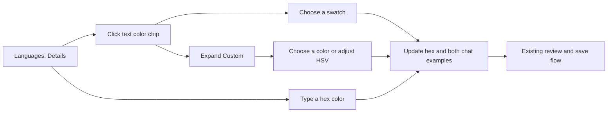

# Native language color picker

Implement the approved swatches-first design in the language editor. Clicking the color chip opens a small palette; Custom reveals a spectrum, hue, saturation and brightness controls. Keep the hex field and both live chat examples visible. VS launches remain paused.

The user has chosen this design. No design decision remains open. The palette keeps common choices compact; Custom costs an extra click in exchange for keeping the full editor visible by default.

## Implementation

1. Add a native popup control using the existing swatch, slider and text widgets plus a small saturation/brightness plane. Handle focus, Escape, outside clicks, drag cancellation and disposal. Keep language colors opaque `#RRGGBB`.
2. Connect it to the existing draft without recomposing the editor during picking. Preserve invalid hex drafts for existing validation and preserve non-palette configured colors.
3. Add standalone capture scenes and focused interaction tests. Render wide and compact windows at scales 1 and 1.25, inspect the images, then run the relevant regression checks and local-only package build.

No new config keys, dependencies, save path, profile changes or deployment. Standalone checks do not establish live GPU rendering or in-game acceptance.

## Results

Implemented the approved palette and Custom spectrum in the production language editor. Custom also has an editable hex field so it remains available when the expanded popup covers the main field at compact sizes. Color changes update both chat examples through the existing draft. Original restores the configured spelling as well as its RGB value, avoiding a false unsaved change.

The [standalone gallery](C:/Users/steve/.codex/visualizations/2026/10/02/01a0fa70-8ca5-7321-ac1f-07fe824f5be2/native-language-color-picker-20261019/gallery.md) contains 28 source-stamped captures across seven language states, two window sizes and two GUI scales. Visual inspection found the palette, selection outline, spectrum, HSV controls and hex entry readable on screen, with both chat examples unobscured.

Final focused checks passed 44 tests. The normal regression run passed 1,471 tests and skipped 127 opt-in visual theory groups. A broader GUI run passed 1,757 tests before the final popup hex field; the final focused checks cover that addition. Capture-report tests passed 19, the mock workflow passed 111 assertions, and agent tooling and whitespace checks passed. Local-only 5.9.1 packaging succeeded, with a source identity matching all 28 capture manifests.

No VS launch, profile change, server operation, deployment or live QA occurred. Native GPU appearance and live interaction performance remain unverified.
