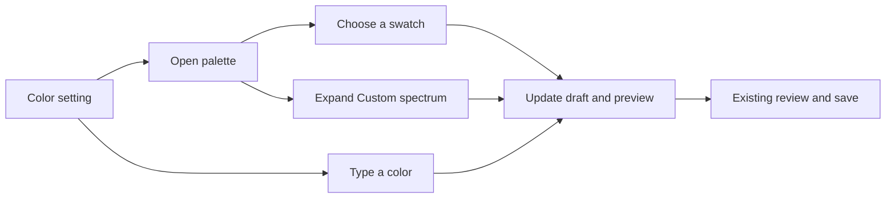

# Color controls across settings

Extend the approved palette with Custom spectrum to the existing chat, nametag and legacy language color fields. Add a Chat colors page so the wizard exposes the same choices as the advanced settings. Scene markers keep their five supported colors, presented as swatches.

The design is already approved. Keep typed values available: chat accepts named colors, nametags accept transparency and an empty value for the game theme, and languages retain opaque RGB. No new configuration format or dependency is needed.

1. Reuse the language picker, adding optional alpha and theme support for nametags.
2. Connect existing dialogs and wizard fields, preserving their text inputs, draft callbacks and save behavior.
3. Verify interaction, restoration, scrolling and compact layouts with focused tests. Render production dialogs standalone and build a local package.

VS launches remain paused. Standalone rendering does not establish live GPU or in-game acceptance.

## Results

Implemented the palette and Custom spectrum for all five existing scalar color settings in both menus, plus the legacy language editor. The wizard now has a Chat colors page with a chat-window preview. Nametags retain alpha and an empty value for the game theme. Scene markers offer their five existing colors as swatches. Existing text inputs, named chat colors and save paths remain available.

The capture pass exposed a scroll scaling mismatch in advanced settings. Correcting the shared scroll offset keeps search targets and their color chips inside the viewport. Captures now assert that the requested popup actually opens.

Native GUI checks passed 169 cases before the final scroll correction. The final run passed 73 checks covering that correction, color controls, search, privilege suggestions and standalone dialogs. These batches overlap. Normal regression passed 1,472 tests and skipped 146 opt-in visual groups. Capture-report tests passed 19, the mock workflow passed 112 assertions, and tooling and whitespace checks passed.

The [46-render gallery](C:/Users/steve/.codex/visualizations/2026/10/02/01a0fa70-8ca5-7321-ac1f-07fe824f5be2/shared-color-settings-20261023/gallery.md) covers two window sizes and GUI scales 1 and 1.25. The scene marker editor keeps its existing size and is captured only at the larger window size. The older language dialog also exceeds the compact viewport at scale 1.25, although its picker fits. Visual inspection confirmed visible color controls, open popups, opacity controls and selection outlines. All manifests match the local-only 5.9.1 package's source identity.

No VS launches, profile changes, server operations or uploads occurred. Native GPU rendering and live in-game QA remain unverified.
