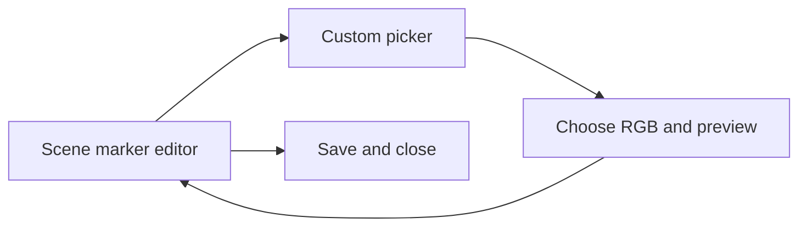

# Scene marker custom colors

Implement the approved five presets plus Custom layout. Custom reuses the spectrum picker with RGB hex entry and updates the existing marker preview. Picking a preset clears Custom. Original restores the opening color and its preset/custom state. Save remains the only action that changes the marker in the world.

The user approved this design and requested implementation on October 25. The alternative, replacing the five inline presets with a single chip, was rejected. Keep RGB opaque because existing distance fading and marker opacity already control transparency. VS launches stay paused.

## Implementation

- [x] Prove the missing custom-color data and editor paths with failing tests.
- [x] Add optional `CustomColorHex`, tree attribute `sceneCustomColor`, and protobuf member 24. Preserve the preset enum and member 15. Validate empty or strict `#RRGGBB` at server save/default boundaries. Carry color through clones, defaults, pickup and re-placement.
- [x] Resolve the same RGB for enum artwork, catalog icons, editor previews and world rendering. Include custom color in icon-cache identity and retain existing texture eviction/disposal.
- [x] Add Custom beside the five presets, reusing native picker input, late popup rendering, focus and disposal. Preserve locks, drafts, unsaved-close prompts and preset restoration.
- [x] Run focused persistence, server, rendering and native GUI checks, then regression tests. Render standalone examples for preset, custom, spectrum, catalog icon and locked states. Build a local-only package with matching source identity.

## Constraints and review

No new dependencies, enum values, config settings, deployment, profile changes or game launches. Malformed network colors must leave existing data intact. Legacy data must retain its preset. Different RGB values must not share a cached icon. Original must not create a false dirty change. Locked markers must stay read-only. Existing mixed-version editors cannot be promised to preserve an unknown custom field.

Standalone previews exercise production widgets and local game assets. They do not establish live GPU appearance or in-game QA acceptance.

## Results

Implemented five presets plus a current-color chip and Custom button in the existing row. Custom opens the shared spectrum. Preview changes stay in the editor draft; preset selection clears the override, and Original restores the opening preset/custom state even when RGB values match. Existing save, defaults, unsaved-close and lock behavior remain intact.

Custom RGB persists through attributes, protobuf, cloning, saved defaults, pickup and re-placement. Invalid network values leave existing marker data and read state unchanged. The world renderer and editor use the same RGB, and the icon cache distinguishes custom colors while preserving its existing eviction and disposal rules.

The [standalone gallery](C:/Users/steve/.codex/visualizations/2026/10/02/01a0fa70-8ca5-7321-ac1f-07fe824f5be2/scene-marker-custom-colors-20261025/gallery.md) contains 20 verified captures across two larger viewports and GUI scales 1 and 1.25. All capture source identities match the archived local-only 5.9.1 package. Visual review found the preset row, spectrum, catalog tint and locked state readable and within bounds.

The initial feature checks failed as expected. Final isolated GUI checks passed 88 tests with no skips. The normal regression run passed 1,509 tests and skipped 151 opt-in visual groups. The earlier targeted storage/server/render batch passed 78 cases. Tooling and whitespace checks passed.

Combined native test runs intermittently stalled in the existing throwing-icon fallback test, which passes alone. Bounded separate runs supply the acceptance evidence. The combined-run stall remains unresolved; no speculative production change was made to hide it. Native-button fixture assertions explicitly allow the two simulated menu sounds and reject other effects.

VS remained paused. No profiles, servers or deployments were changed, and live GPU/in-game QA remains pending. The editor retains its existing larger-window sizing requirement.
