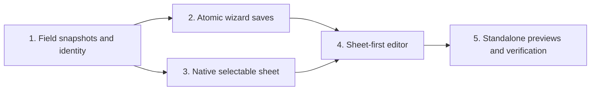

# Character-sheet builder implementation plan

> **For agentic workers:** REQUIRED SUB-SKILL: Use superpowers:subagent-driven-development or superpowers:executing-plans to implement this plan task-by-task. Steps use checkbox syntax for tracking.

**Goal:** Build the approved sheet-first server-template editor inside Characters, with the actual sheet renderer, fictional preview answers and one wizard save flow.

**Architecture:** Extend the existing wizard snapshot/draft/save path with optional character-field collections. Add an embedded template-preview mode to CharacterSheetDialog so selection uses its actual field geometry without copying its layout. A focused SetupWizardSheetEditor owns the inspector and coordinates that preview.

**Tech stack:** Existing C#, .NET 10, Vintage Story GuiComposer/Cairo, protobuf-net, xUnit and tools/GuiPreview. No new dependencies.

**Spec:** [Approved character-sheet builder design](../specs/2026-10-26-character-sheet-builder-design.md).

## Global constraints

- VS launches remain paused. No profile modifications, server upload/restart, deployment, merge or release.
- Preserve the dirty worktree and all existing wizard work. Stage only this feature's hunks if making local checkpoints; do not bundle earlier work or publish changes as part of this plan.
- Reuse the actual character-sheet layout, selection geometry and visibility rules. No duplicate sheet renderer or invented preview-only gameplay.
- Template edits stay in the existing wizard draft until review/save. Do not send player-answer save requests or call the legacy editor's independent save handler.
- New fields use `field-` plus a fresh GUID in N format, generated once. All IDs are read-only in the builder; existing IDs remain unchanged.
- Keep the existing input, visibility and layout model constants and protobuf tags intact. The existing four field types remain the only supported types.
- Preserve validation, server root authorization, request correlation, conflict checking, unknown-save recovery and saved-but-restart-required behavior.
- Do not migrate, scan, erase or purge player answers. Do not change the legacy field editor's ID-generation behavior.
- Use ordinary English labels and existing styled toggles. No em dashes in human-facing copy.
- All captures are standalone evidence until native GPU and in-game checks are separately authorized.

## Review focus

1. A removed label recreated in another session gets a new ID and cannot reconnect an old stored answer. Task 1.
2. An answer widget under a selected field must never receive typing or invoke a player save. Tasks 3 and 4.
3. A field hidden by a preview-context change remains editable in the inspector, without appearing as a ghost field. Tasks 3 and 4.
4. A reply to an earlier save must preserve newer template edits and a timed-out save must block reset/retry until readback. Task 2.
5. Half-width pairing, portrait rows and scrolling must keep hit testing aligned at GUI scales 1 and 1.25. Tasks 3 and 5.

## Delivery sequence

No public UI entry appears before its data and save paths work. Task 5 produces the first appearance checkpoint; user approval of those frames is separate from software checks.

## File ownership

Paths below are relative to `mods-dll/thebasics/src/`, unless explicitly rooted elsewhere.

| Area | Existing files to change | New file, only where needed |
|---|---|---|
| Field snapshots/validation | `ModSystems/AdminConfig/CharacterSheetFieldConfigAdmin.cs` | None |
| Wizard storage/network | `Models/TheBasicsSetupWizardRequestMessage.cs`, `Models/TheBasicsSetupWizardResultMessage.cs`, `ModSystems/AdminConfig/SetupWizardState.cs`, `ModSystems/ChatUiSystem/SetupWizardDraft.cs`, `ModSystems/ChatUiSystem/SetupWizardClientController.cs`, `ModSystems/ProximityChat/RPProximityChatSystem.SetupWizard.cs` | None |
| Sheet rendering/selection | `ModSystems/ChatUiSystem/CharacterSheetDialog.cs`, `ModSystems/CharacterSheets/CharacterSheetSystem.cs` | `ModSystems/ChatUiSystem/GuiElementSheetFieldSelection.cs` |
| Builder | `ModSystems/AdminConfig/SetupWizardCatalog.cs`, `ModSystems/ChatUiSystem/SetupWizardDialog.cs` | `ModSystems/ChatUiSystem/SetupWizardSheetEditor.cs`, `ModSystems/ChatUiSystem/SetupWizardSheetPreview.cs` |
| Copy, analytics and capture | `assets/thebasics/lang/en.json`, existing fixed journey identifiers, `tools/GuiPreview/PreviewScene.cs`, wizard capture scene definitions and `tools/GuiPreview/README.md` | Tests listed per task |

Do not move unrelated dialog code into new modules. The preview coordinator owns/disposes its embedded dialog and existing actor layer; the editor owns/disposes the coordinator. Shared dialog mode must retain normal sheet error handling and draft preservation.

## Task 1: Stable template snapshots and field identity

**Files:** existing CharacterSheetFieldConfigAdmin plus new tests under `mods-dll/thebasics.Tests/ModSystems/AdminConfig/CharacterSheetFieldSnapshotTests.cs` and `.../ChatUiSystem/SetupWizardSheetDraftTests.cs`.

**Interfaces:** Add `CloneEntries(IEnumerable<CharacterSheetFieldConfigEntryMessage>) -> List<CharacterSheetFieldConfigEntryMessage>` and `EntriesEqual(IEnumerable<CharacterSheetFieldConfigEntryMessage>, IEnumerable<CharacterSheetFieldConfigEntryMessage>) -> bool` to CharacterSheetFieldConfigAdmin. Equality preserves field order and persisted property values while ignoring the client-only AutoGenerateId flag. Add `CreateBuilderEntry() -> CharacterSheetFieldConfigEntryMessage` with a fresh stable ID, blank label, string type, optional/public/body/full defaults and AutoGenerateId false. Keep existing GenerateSuggestedId unchanged.

- [x] Write tests for independent clones, every persisted field property, order changes and ignored client-only flags. Assert two newly created entries have different `field-<32 hex digits>` IDs, and changing a label does not change its ID.
- [x] Prove a cross-session remove/save/re-add using the same label resolves an empty new value while retaining the old stored answer under its old ID. Reuse CharacterSheetSystemTests fixtures; no new player store.
- [x] Run the new tests and record expected failures before implementation. Use `dotnet test mods-dll/thebasics.Tests/thebasics.Tests.csproj -p:SkipPostBuildPackage=true --filter 'FullyQualifiedName~CharacterSheetFieldSnapshotTests|FullyQualifiedName~SetupWizardSheetDraftTests'`.
- [x] Implement the helpers and extend SetupWizardDraft with optional constructor argument `IEnumerable<CharacterSheetFieldConfigEntryMessage> fields = null`, `SheetFields`, `OriginalSheetFields`, `SheetFieldsChanged`, `RefreshSheetFields(...)` and `ResetSheetFields()`. Include `CharacterSheetFields` in ChangedKeys when edited. Reset changes only field edits and is forbidden during pending/unknown saves.
- [x] Re-run the focused tests and existing CharacterSheetFieldConfigAdminTests. Do not change legacy ID generation or config normalization to accommodate the builder.

## Task 2: One atomic save with conflict and timeout handling

**Files:** wizard packet, state, draft, controller and server files in the map. Extend existing SetupWizardProtocolTests, SetupWizardStateTests, SetupWizardServerTests and client-controller tests, plus SetupWizardSheetDraftTests.

**Interfaces:** Append request `SheetFields` at ProtoMember 12 and `OriginalSheetFields` at 13, both lists of the existing entry message. Append result `SheetFields` at 13. Default to empty lists. Presence means either request list is nonempty; no lists means no template patch. Empty new list plus nonempty original means an attempted delete-all, rejected by existing validation. New clients disable builder editing if an older server sends no snapshot, while allowing unrelated settings saves.

- [x] Add failing protocol tests proving request tags 1-11 and result tags 1-12 remain unchanged. Decode old packets and verify absence cannot clear fields; asymmetric, null or malformed collections must not be silently accepted as complete edits.
- [x] Add validation/conflict tests: scalar+language+field success writes once; invalid field, duplicate binding, all-fields removal, stale original or write failure writes nothing. Another legacy editor's save must trigger a field-snapshot conflict.
- [x] Bound edited snapshots to 256 fields, 8192 characters per string property, and 1 MiB total string characters across new/original fields, before deeper validation. Reuse narrower existing field validators afterward. Count both snapshots. Oversized existing snapshots remain viewable but field editing is unavailable with a readable reason; unrelated scalar/language saves still work. Never truncate or quietly drop fields.
- [x] Extend the existing `TryValidatePatch` and result snapshot path. Clone fields into the full draft; validate through CharacterSheetFieldConfigAdmin before persistence. Add CharacterSheetFields to changed keys and reuse existing side effects/broadcast. Keep legacy saves separate.
- [x] Extend existing CreateSaveRequest/MergeSaveResult/MarkSaveTimedOut/MergeSaveReadback behavior for fields. Retain submitted snapshots and only replace matching submitted values after acknowledgement, preserving later local edits. Confirm duplicate requests do not persist twice, unknown requests do not rebase, lost replies require readback, and failed readback keeps reset/save blocked.
- [x] Run focused wizard protocol/state/server/draft/controller tests. Add a post-persist runtime-failure case asserting saved configuration plus the existing restart-required result, never an unsaved-success claim.

## Task 3: Selectable preview through the actual sheet dialog

**Files:** CharacterSheetDialog, CharacterSheetSystem, new GuiElementSheetFieldSelection and SetupWizardSheetPreview. Tests: `.../ChatUiSystem/CharacterSheetTemplatePreviewTests.cs`, `.../ChatUiSystem/SetupWizardSheetPreviewTests.cs`, existing CharacterSheetDialog and CharacterSheetSystem tests.

**Interfaces:** Add an internal `void ConfigureTemplatePreview(ElementBounds bounds, Action<string> onFieldSelected, Action<GuiComposer, ElementBounds> addPortrait)` entry point on CharacterSheetDialog. It recomposes at embedded bounds and exposes `internal GuiComposer TemplatePreviewComposer` for the preview owner. Add `internal void SelectTemplateField(string fieldId, bool scrollIntoView)`. Keep the existing public constructor and SetView API unchanged. Selection elements use the same header/body cell bounds calculated by existing composition helpers. A normal sheet never enables template mode.

SetupWizardSheetPreview accepts the API, actor factory, draft fields and a selected-ID callback; exposes `void Refresh(IReadOnlyList<CharacterSheetFieldConfigEntryMessage> fields, string selectedId, SheetPreviewContext context, bool filled)`, `void SelectField(string id, bool scrollIntoView)` and Dispose. SheetPreviewContext is an internal enum `Player`, `OtherPlayer`, `NearbyInspection`, `Staff`. Build local CharacterSheetViewMessage objects, never fetch or save player data. Share the existing pure visibility predicate with CharacterSheetSystem so the preview cannot diverge.

- [x] Add failing tests comparing unchanged production sheet bounds/content with template-mode content before selection decoration. Normal dialog save, reopen and unsaved-draft tests must remain green.
- [x] Add native hit-testing tests for portrait cells, full rows, consecutive half-width rows and scrolled rows at scales 1 and 1.25. Assert pointer and keyboard selection give the correct ID and selecting an answer control records no answer edit, request or sound beyond explicitly expected native UI effects.
- [x] Implement selection as a small focusable overlay per actual field cell, with distinct focus/selection outlines and clipping. It consumes clicks/keys before underlying answer controls, allows sheet scrolling and never enables the sheet's player Save action. Do not open a second top-level game dialog.
- [x] Generate deterministic local samples by actual type/options and limits. Render the existing seraph through the actor layer in the portrait slot. Filled/Empty and context changes retain selection even if the field becomes hidden. NearbyInspection uses existing inspection formatting and native chat presentation, not the sheet renderer.
- [x] Preserve the last valid rendered snapshot during invalid edits. Mark a new incomplete entry as an explicitly unfinished Untitled field outline; do not insert it into a valid server view message. Add tests for invalid choice options, hidden selection and all-fields-hidden views.
- [x] Run the new native tests in a bounded isolated GUI process, plus normal sheet/system regressions. Use the existing standalone collection; do not conceal unsupported calls or reuse an old screenshot as fresh evidence.

## Task 4: Sheet-first editor, review and recovery

**Files:** new SetupWizardSheetEditor; existing catalog, wizard dialog, client controller, localization and fixed analytics validation. Tests: `.../ChatUiSystem/SetupWizardSheetEditorTests.cs`, `.../ChatUiSystem/SetupWizardSheetReviewTests.cs`, catalog/capture/journey tests.

**Interfaces:** SetupWizardSheetEditor follows SetupWizardLanguageEditor ownership and event queuing, consuming SetupWizardDraft and the preview. Provide `Add(GuiComposer composer, double width, bool compact)`, `Refresh()` and Dispose. Register page ID `characters.builder` after characters.sheets. Reuse wizard navigation/footer; builder edits never call legacy Save.

- [x] Add failing native tests for clicking a field, properties selection, All fields drawer, hidden selection status/Show staff view, add/remove confirmation and section-relative movement. Assert IDs stay fixed, other fields keep relative order and placement changes append within the chosen section.
- [x] Compose label, description, type, Required toggle, visibility, inspection toggle, conditional choice rows, character limit, placement, width and long-text height. Advanced contains binding and copyable read-only ID. Preserve temporarily irrelevant draft values; normalize only through existing validators on save. Ineligible disabled settings retain their stored values.
- [x] At content width below `520 + 20 + 280` logical pixels, keep the normal-width sheet and show a returning inspector instead of squeezing text. Back to sheet restores selection/scroll. Test both sides of this threshold at scales 1 and 1.25; include a 1280x720 viewport capture and report any pre-existing shell limitation.
- [x] Keep focus/caret in the inspector while typing. Update only preview content when possible; do not recompose the whole wizard for each keystroke. Preserve scroll through add/reorder/context changes and page navigation. All operations have keyboard equivalents.
- [x] Add the approved grouped before/after review rows and exact consequential-edit copy from the spec. A net-reverted edit produces no warning. Required-field RP warnings depend on the actual gate and eligible visibility. Include Reset/Reload sheet fields confirmation that preserves scalar/language edits and adopts the authoritative conflict snapshot.
- [x] Keep editing available while character sheets are off, with the disabled-feature explanation; do not enable them automatically. Track only fixed builder actions and count buckets through existing journey analytics. Add tests asserting no labels, descriptions, options, IDs or sample answers are recorded.
- [x] Run editor, review, controller, catalog and journey tests. Dispose selection overlays, popup/drawer, embedded compositor and actor textures on close/recomposition; test no stale callbacks after disposal.

## Task 5: Appearance checkpoint and final verification

**Files:** tools/GuiPreview/PreviewScene.cs, wizard capture scenes, preview README and tests under `mods-dll/thebasics.Tests/GuiPreview/`; dated gallery and evidence under the existing visualization root.

- [x] Add production-dialog fixtures `wizard-sheet-builder`, `wizard-sheet-builder-selected`, `wizard-sheet-builder-choice`, `wizard-sheet-builder-hidden`, `wizard-sheet-builder-empty`, `wizard-sheet-builder-inspector`, `wizard-sheet-builder-invalid` and `wizard-sheet-builder-review`. Supply fixture fields through real wizard snapshots. Include custom field names, portrait/body placement, half-width pairing, one staff field and actual choice options.
- [x] Capture these scenes at 1600x1000 and 1280x720, GUI scales 1 and 1.25. Native tests drive actual field selection and inspector controls before capturing. Include first/last scrolled rows and keyboard focus. Require zero unsupported calls and zero unexpected effects.
- [x] Render through `scripts/preview-gui.ps1 -GamePath D:/Games/Vintagestory -Scenario <scene> -Scale <scale> -Width <width> -Height <height> -Output <new-directory>`. Reuse existing batch/manifest helpers rather than creating another capture system.
- [ ] Show the standalone selection, compact inspector and choice-field frames to the user as the appearance checkpoint specified in the design. Retain remaining frames in a linked gallery. Do not call pending human approval or live QA complete.
- [x] Run focused field/protocol/server/draft tests, then normal regressions separately from opt-in native GUI batches. Use bounded hang detection for native runs. The previous combined native-run stall is unresolved; record any stall and nonzero exit, not a partial Passed summary.
- [x] Compute source identity with `scripts/gui-source-identity.ps1`. Build with `mods-dll/thebasics/scripts/build-and-package.ps1 -LocalOnly -SourceTreeHash <hash> -ReceiptPath <new-receipt>`. Archive that exact ZIP beside the gallery, verify matching hashes/manifests and reject stale same-version artifacts.
- [x] Record actual test counts, skipped groups, image provenance, source/package hashes and known viewport/runtime limitations. Check the scoped diff and whitespace. No VS launch or deployment follows verification.

## Plan self-review

- Every approved interaction has an owner: identity and reset in Task 1; atomicity, legacy/mixed-version saves and conflict recovery in Task 2; actual renderer, filtering and selection in Task 3; inspector/navigation/review/analytics in Task 4; visual evidence and packaging in Task 5.
- Existing language/scalar APIs remain in place. Sheet-specific data appends to their established integration instead of refactoring unrelated saves.
- No tests are claimed run by this document. No implementation is claimed complete. Native GPU, multiplayer, release readiness and human appearance acceptance remain unverified.

## Results, October 27

Implemented and reviewed all five tasks. The standalone gallery is the appearance checkpoint for the user; it does not complete human appearance approval or in-game QA.

- Final normal regressions: 1,557 passed, 166 opt-in native cases skipped. Separate native fixture/viewport run: 37 passed, followed by 8 affected choice/error cases after final fixture scrolling adjustments.
- Final source and archived package match all 32 PNG/manifest hashes. Unsupported calls and unexpected effects: zero.
- Whole-feature review and scoped final fixes approved. Additional visual inspection found and fixed embedded positioning, inspector clipping and clipped pointer-release behavior, with native pixel/input regressions.
- No staging, commits, push, profile changes, game launch, server operation or deployment. Existing dirty prerequisite work was preserved.

[Standalone gallery](C:/Users/steve/.codex/visualizations/2026/10/02/01a0fa70-8ca5-7321-ac1f-07fe824f5be2/character-sheet-builder-20261027/gallery.md) and [artifact verification](C:/Users/steve/.codex/visualizations/2026/10/02/01a0fa70-8ca5-7321-ac1f-07fe824f5be2/character-sheet-builder-20261027/verification.json).

### Decisions during implementation

- Kept exact working-file task snapshots rather than committing shared dirty files. This preserves earlier work but leaves a separate checkpoint/publication step.
- Used sequential integration agents and independent task/final reviews. This costs additional execution time; no parallel shared-file writers were used.
- Extended existing review/save callers for the template collection before the inspector existed. The temporary summary was replaced by the final grouped review.
- Used measured outer sheet width 550 rather than the inner 520 constant. The returning inspector starts below 850 logical pixels, sooner than the original estimated breakpoint.
- Rejected blank/duplicate active choice rows only in the wizard save path. The legacy editor retains its normalizer, so malformed choices are handled differently there.
- Retained the ledger and snapshots because no feature commits exist yet. This keeps recovery evidence at the cost of local scratch storage until a durable checkpoint.
