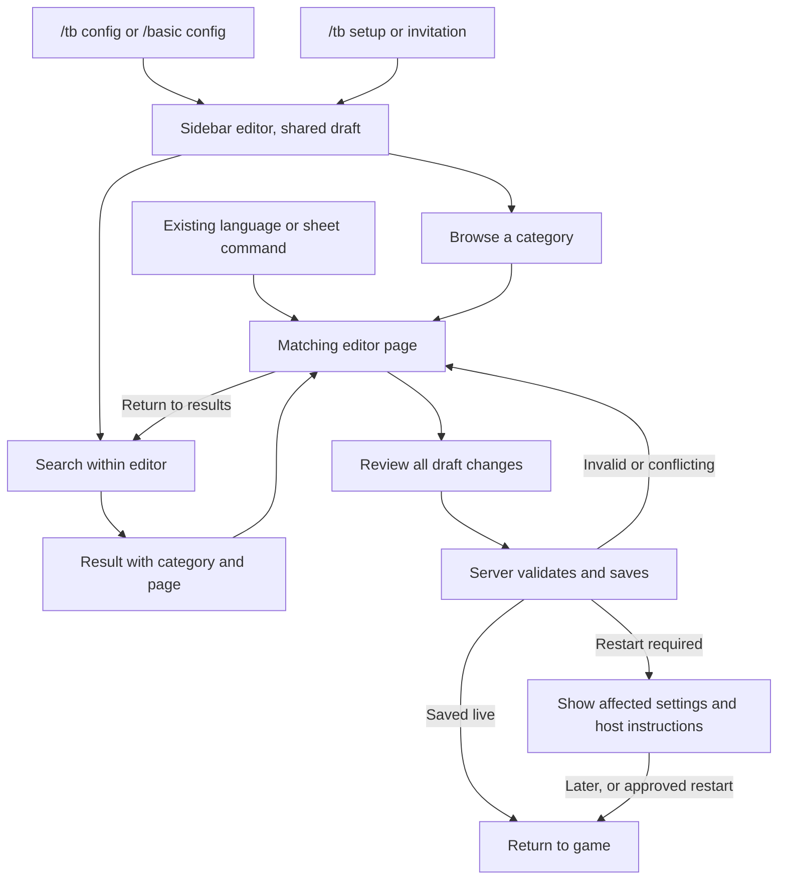

# Retiring the old configuration menu

Status: approved October 28, 2026, with per-task subagents. Implementation is in progress. Profile2 stays unchanged; standalone previews precede any later refresh. Default-route changes and legacy-window deletion retain their human QA gates.

## Recommendation

Make the current sidebar editor the main configuration UI, complete its missing settings and search, then retire the old windows. Keep a temporary `/tb config advanced` fallback while we finish migration and human QA.

The audit found **75 missing settings out of 210 registered settings**, rather than a small handful. Most belong to repeated speech-mode controls or formatting shortcuts. The proposed layout adds **10 pages within the existing eight categories** and extends six existing pages. It does not add another navigation tier or a separate advanced editor.

This proposal covers everything available through the old menu, including actions and direct commands. It does not claim that every property in the mod's JSON configuration is currently editable through either UI.

### Decisions to review

| Decision | Recommendation | Tradeoff |
|---|---|---|
| Advanced settings placement | Give detailed settings ordinary sidebar pages within their feature category. | More sidebar entries, but each setting has a predictable home and can be searched. |
| Search presentation | A search field above the sidebar, with results in the existing content area. Selecting a result opens and highlights its field. | Uses content space while searching; avoids another modal layered over the editor. |
| When to change `/tb config` | After all 210 registered settings and old-menu actions have replacements and targeted QA passes. | Delays the command switch, but people cannot discover a missing option only after being redirected. |
| Temporary fallback | Keep `/tb config advanced` through a separately reviewed compatibility period, then remove the old windows. | Briefly maintains both implementations, with an explicit deletion checklist. |

The fallback period is not a proposed fixed number of releases. Decide that when the replacement is validated.

### Confirmed constraints

- Preserve the eight-category sidebar and the shared draft, Review, Save and restart guidance.
- Languages use one scrollable form. Keep the language selector and chat previews visible.
- Use the current boolean toggles, color pickers and editable privilege suggestions.
- Preserve freeform privilege strings, exact configured IDs and existing accepted configuration values.
- Show a visualization when a setting changes something a player can meaningfully see. Use actual rendered seraphs and faithful game UI where relevant.
- Do not add nested settings menus to fit the remaining options.
- Show standalone previews before refreshing Profile2. No client refresh is authorized by approving this plan alone.

## What administrators would experience

An administrator enters with `/tb config`, `/basic config`, `/tb setup` or the existing invitation. They arrive in the same editor and can browse or search.

Search matches friendly labels, exact config keys, help text, configured languages and sheet-template fields. A result shows its category and page. Selecting it reveals the right field, including a field below the fold. Returning to results restores the query and result position. Searching and navigating never saves or replaces the draft.

The editor keeps one Review and Save flow for scalar settings, languages and the sheet template. A conflict rejects the entire attempted save. Validation failures and uncertain save results retain the draft. Restart guidance appears after saving when required.

### Proposed journey: find and change a setting

Current experience: `config` opens the old menu; setup's All settings button opens it too. Search and the old direct language/sheet commands can open separate editors with separate drafts.

Transition: those existing routes remain intact until their replacements pass QA. The temporary advanced command remains available after the default changes.

Final experience: all normal configuration routes lead to the sidebar editor. The old UI is deleted once its compatibility checklist is satisfied.

## Settings migration

The [complete inventory](2026-10-28-config-menu-inventory.md) lists every missing key, its current group, proposed destination and registry activation classification.

Talk in the UI corresponds to the `Normal` mode in configuration keys. Mode tables must preserve that distinction without displaying raw enum names.

| Destination in the sidebar | Missing keys | Controls and useful preview |
|---|---:|---|
| Chat > Speech wording, new | 13 | Rows for Whisper, Talk and Yell verbs, question verbs and punctuation; babble wording, prose nickname token, attribution and RP-text toggle privilege. Show representative fake chat messages, with literal markup safely escaped. |
| Chat > Formatting shortcuts, new | 18 | Nine labeled start/end pairs for bold, italics, emotes, environmental text, placed environmental text, local/global OOC, quotes and signing quotes. Show typed input beside its resulting chat text. Keep permitted empty closing delimiters. |
| Chat > Text appearance, new | 9 | Font sizes by speech mode, distance resizing, font-size limits, bold/name colors and formatting isolation. Show the same chat message at two distances. Explain isolation with a bounded malformed-formatting example. |
| Chat > Speech voices, new | 7 | Volume and pitch for Whisper, Talk and Yell; self-volume multiplier. Group controls by mode. A visual meter may explain values but is not proof of audible output. |
| Chat > Text-to-speech, new | 6 | Gain and falloff by mode. Show the integration's availability without preventing advance configuration. Do not synthesize speech through an external service just to render this page. |
| Chat > Walls and visibility, new | 6 | Clear-sound-path switches by mode, wall muffling penalty and two block-pattern lists. Show a faithful small scene for walls; use clear field help for code patterns. Keep the experimental behavior identified. |
| Chat > Opening and switching tabs, existing | 2 | Proximity tab name and position. Reuse the fake game chat window to show tab ordering and naming. |
| Chat > Languages and OOC, existing | 1 | Global OOC nickname/account-name choice. Show a sample OOC line. |
| Teleportation > Saved homes / World spawn, existing | 2 | Permissions for setting homes and spawn, alongside the corresponding use permissions. Preserve custom privilege text. |
| Notifications > Nearby deaths, new | 1 | Nearby death-message switch, with a representative chat line and an explanation of audience. |
| Roleplay tools > Placed descriptions, new | 1 | Environmental-message placement range. Use a distance example. This is not the scene-marker feature. |
| Server tools > History limits, existing | 1 | Disk flush interval with explicit milliseconds and restart guidance after saving. No decorative preview needed. |
| Server tools > Player activity stats, existing | 6 | Five tracking switches and the movement-sampling interval. Grey dependent controls where appropriate without clearing values. Explain the interval's milliseconds. |
| Server tools > Integrations, new | 1 | th3essentials Discord relay switch and availability/help. Toggling a draft must never send a Discord message. |
| Server tools > Diagnostics, new | 1 | Debug logging switch and concise explanation. No fake graphical preview. |
| **Total** | **75** | **All missing registered keys assigned.** |

The registry classifies three of these missing settings as requiring a restart: the Proximity tab name, history flush interval and movement-tracking interval. Verify the actual consumer behavior for every migrated setting; a registry label alone is not runtime proof.

### Preview review points

Show standalone renders of the mode tables, formatting pairs, sight-pattern lists and search results before installing them in Profile2. These have the highest layout and interaction risk. Reuse the current previews for simple additions instead of inventing artwork for every field.

Keep forms usable at 1280x720, GUI scales 1 and 1.25. Keyboard navigation must reveal clipped fields, labels and controls must share disabled styling, and popup tooltips must suppress background tooltips.

## Old-menu behavior that also needs a replacement

| Existing behavior | Proposed replacement | What must be preserved |
|---|---|---|
| Search across settings, languages and sheet fields | Search inside the current editor | Exact keys, descriptions, renamed entries, new entries, draft values, query and position on return. Search template fields, never player answers. |
| New-setting labels and Mark reviewed | A New settings search filter and an explicit Mark all new settings reviewed action | Keep `ReviewedConfigSettingKeys` and make the action's all-settings scope clear. Visiting a page or saving an unrelated edit must not silently mark everything reviewed. |
| Reload from disk | Server tools maintenance action, plus existing `/tb reloadconfig` | Explain and confirm discarding a dirty draft. A broken file must leave runtime settings unchanged and show an error. If a valid file loads but live application fails, report a distinct partially applied reload, retain unsaved edits, read back the loaded configuration and explain the required restart. Opening setup again is not a disk reload. |
| Handbook button | A Help action that opens the existing handbook | Preserve the draft and return position. Keep `/tb guide` / handbook aliases. |
| All settings button in setup | Remove after parity; search and sidebar reach everything | During transition the fallback stays explicit. Do not disguise the old UI as another new-editor page. |
| Separate language and sheet editor commands | Deep links into Languages and Sheet builder | Existing aliases, root permission, selection/focus where supported, and shared draft behavior. |
| Direct legacy editors' save paths | Shared Review and Save | No accidental new save merely from opening a command. Keep the server validators and template identity/answer-retention rules. |
| Legacy scalar save status and restart handling | Existing setup result/restart screens | Whole-save validation, persistence errors, runtime-apply failure, pending restart keys and safe retry. |
| “Setup could not open” fallback | Point explicitly to `/tb config advanced` during transition | Switching `/tb config` must not turn its current fallback message into a loop back to the failing editor. |
| Group selection and unsaved navigation | Sidebar, field focus and retained scroll positions | No second draft, silent discard, or jump to the wrong repeated control. |
| Legacy packets and shared validators | Separate compatibility decision | Retiring windows does not authorize deleting validators or changing existing ProtoMember numbers. |

## Delivery order

1. **Lock down the inventory and coverage checks.** Every current registry entry must be either reachable in the new UI or explicitly tracked as pending migration.
2. **Fill the smaller gaps.** Chat tab name/order, OOC naming, home/spawn permissions, nearby deaths, placement distance, stats, history, diagnostics and relay.
3. **Build the text editors.** Speech wording, formatting shortcuts and text appearance, using tables and one continuous form per page.
4. **Add sound and sight controls.** Speech voices, TTS and wall/visibility settings, with truthful availability and preview limits.
5. **Bring search and old-menu actions into the shared draft.** Replace the old-menu navigation dependencies.
6. **Test command compatibility, then switch the default entry point.** Retain the explicit advanced fallback.
7. **Delete the old windows after acceptance.** Remove obsolete client lifecycle and navigation code, then decide packet compatibility separately.

See the [implementation checklist](2026-10-28-config-menu-retirement-implementation.md) for files, interfaces and test ownership. Each stage should be independently reviewable; none needs a production release to be useful.

## Conditions for retirement

The default route can change when all registered keys have working controls, all structured editor fields remain available, search and legacy actions have replacements, and the following tests pass:

- A new registry setting cannot disappear silently because nobody assigned it to a page.
- A mixed draft containing a newly migrated scalar, language edit and sheet edit saves atomically.
- Unknown keys, unauthorized requests, stale baselines, invalid patterns/delimiters and invalid field templates cannot partially save.
- A setting hidden behind a dependency retains its value. Arbitrary privilege IDs, accepted strings, numeric precision and existing sentinels survive unchanged.
- Restart-required settings identify the correct action after save. No automatic server restart occurs.
- Direct commands, search navigation and closing/reopening cannot create competing drafts or silently lose edits.
- Color popups, dropdowns, keyboard focus and scrolling remain usable at both compact scales.

Deleting the fallback additionally requires explicit human QA completion, no remaining UI calls into it, an updated setup-failure recovery path, and an agreed policy for supported older clients.

Human QA should use the existing cards, extended for these pages and actions, rather than restarting unrelated tests from scratch. Keep integration output, file reload and the final restart in separate controlled batches.

## Deferred work

- Settings that exist only in JSON and were never in the old menu need a separate audit. They are not included in the 210-setting parity claim.
- New animation systems, external TTS generation, video-review infrastructure and additional presets are not required for this retirement.
- Production rollout, public announcements, merges and deleting old network contracts are outside this planning request.
- No game launch or Profile2 refresh is part of this plan-writing work.

## Evidence appendix

### Source audit

The inventory was read from the locally compiled current `ConfigAdminSettingRegistry.Settings` and `SetupWizardCatalog.Pages`. Counts are by distinct registry key, including expanded speech-mode dictionaries, delimiters and stat switches. It contains no server configuration values.

Key source areas:

- `mods-dll/thebasics/src/ModSystems/AdminConfig/ConfigAdminSettingRegistry.cs`, `SetupWizardCatalog.cs`, `SetupWizardState.cs` and `ConfigAdminSearch.cs`.
- `mods-dll/thebasics/src/ModSystems/ChatUiSystem/ChatUiSystem.cs`, `SetupWizardDialog.cs`, `SetupWizardDraft.cs` and `SetupWizardClientController.cs`.
- `mods-dll/thebasics/src/ModSystems/ProximityChat/RPProximityChatSystem.cs` and `RPProximityChatSystem.SetupWizard.cs`.
- `mods-dll/thebasics/src/Models/TheBasicsSetupWizardRequestMessage.cs` and `TheBasicsSetupWizardResultMessage.cs`.

Read-only audit files: `.tmp/legacy-menu-uncovered.json` and `.tmp/legacy-menu-registry.json`. Recompute counts before implementation if the registry changes.

### Search-flow references

Bounded Mobbin research on October 28, 2026 used the web query “searching settings and changing a setting”, limit two. All three returned positions in each flow were inspected through inline previews. No high-resolution images were downloaded or embedded, and no external collection was changed.

| Reference | Observed sequence | Relevant idea | Limits |
|---|---|---|---|
| [Devin: Searching Devin](https://mobbin.com/flows/3dfd8742-a867-4d67-8211-0ad7fd7bbbe1) | 1: main workspace; 2: search/command overlay; 3: filtered results with Settings category paths | Results should identify the setting's location, not just match a bare label. | Structural reference from a general workspace search. No setting edit, save or draft recovery is shown. |
| [Grok: Searching settings](https://mobbin.com/flows/61015bc4-cd1b-409f-a058-ec8293e00495) | 1: account settings; 2: grouped search actions; 3: query-filtered actions | Search can organize results by the same settings categories used for browsing. | No destination selection or subsequent edit is shown. |

Both references use overlays. The recommendation to show results in the existing content area is our adaptation to this mod's already layered native UI and the owner's request to reduce nested menus. The references do not establish draft retention or usability; those remain requirements for our tests.
