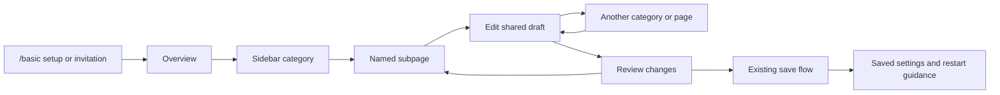

# Native setup sidebar

The owner approved prototype B, the expandable sidebar. Replace the category tabs and small Previous/Next/page-picker controls with one left navigation area. All eight category headers stay available. The selected category reveals named subpages, the current subpage is highlighted, and a long subpage list scrolls independently. Keep Review beside Close in a shared footer.

The approved browser prototype is retained on `codex/wizard-sidebar-prototype`, commits `1d414b0` and `076a3be`, under `tools/GuiPreview/Prototypes/Sidebar/`. Its browser rendering is a design reference. Implement with the game's native GUI and existing production previews, without importing the browser code.

## Confirmed behavior

- Retain the eight categories and 40 catalog page IDs. Keep all subpages discoverable, including configuration for travel commands that are currently off. Existing dependent field visibility and save validation continue to apply.
- Remember each category's last visited page. Preserve the shared draft through category, Overview and Review navigation.
- Highlight the selected leaf and show small unsaved-change indicators on affected pages/categories. Selecting or restoring a page reveals that leaf within the inner scroll area.
- Keep category rows visible while scrolling the selected branch. Short branches stay compact. Use the prototype's short sidebar labels where needed; full page titles remain in the editor.
- Keep Overview's category cards, the existing previews, All settings, unsaved-close protection, reviewed changes, saving, failure messages and restart guidance. Remove the obsolete top category bar, Previous/Next, All topics and bottom page dropdown.
- Use ordinary pointer cursors for navigation. Support mouse, wheel/scrollbar and keyboard navigation without allowing input to leak into settings behind the sidebar.

## Native layout decisions

Keep the existing editor's 880 logical-pixel width where the viewport permits. Add a 236-pixel sidebar with a 24-pixel separation. In narrower clients, reduce the editor/control width while retaining the 310-pixel preview and compact vertical layout. Verify 1600x1000 and 1280x720 at GUI scales 1 and 1.25. Use a stable dialog height so category navigation does not resize the window.

The native implementation retains current form controls and copy. The prototype's simplified previews and incidental control differences are outside this change. No config keys, network fields, privilege handling, save semantics or analytics vocabulary change.

## Find and edit a setting

The owner has approved the navigation direction. Human checks of the native result remain separate from automated rendering, and merge/release approval is not part of this request.
