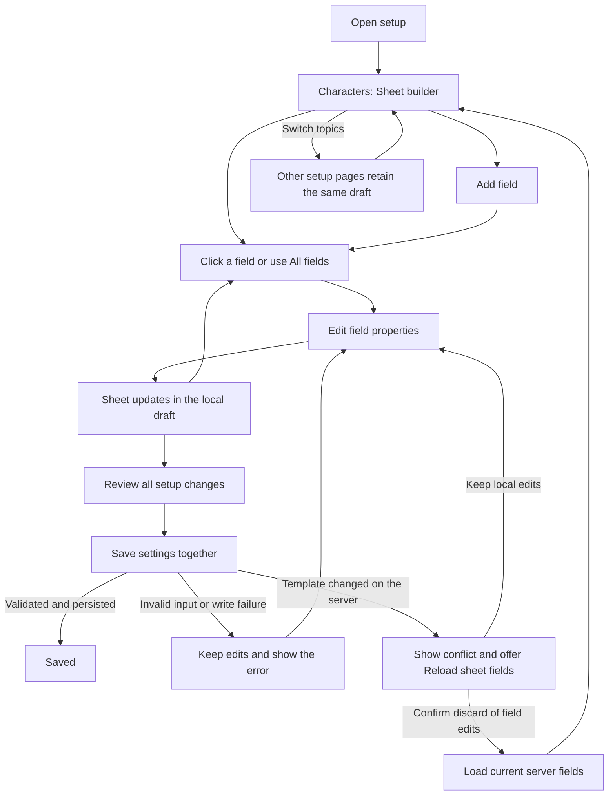

# Character-sheet builder

## Approved design

Let server administrators build their shared character-sheet template by selecting fields on the rendered sheet and editing their properties beside it. Show the server's actual configured fields, with fictional answers from Pip. Changes join the existing setup draft, review and save process.

The user chose the sheet-first approach and approved this design on October 26, 2026. It is a design, not an implementation or a claim of in-game verification. VS launches remain paused.

The approved interaction choices are:

- Keep the sheet central, with a properties panel beside it on larger windows and a returning inspector panel on smaller windows.
- Use explicit movement controls for the first version. Free dragging and resizing are deferred.
- Preserve existing answers when changing the template. Explain potentially incompatible changes before saving; do not add a bulk data migration tool.
- Give each new field a fresh internal ID, so recreating a removed label does not accidentally reconnect old answers. Keep technical IDs read-only in this builder.

## What administrators do

Open **Characters > Sheet builder** in the existing setup sidebar. The sheet displays the configured template at its normal text size, with Pip's portrait and fictional answers. A short line above it says **Editing the server's sheet template**. Do not put instructions or implementation explanations inside the sheet.

Click a field to select it. A thin outline identifies the selected field, including its label and answer area. Its properties appear beside the sheet. Selecting a field does not focus its answer input or edit Pip's answer. Keyboard users can reach and select the same fields, with a visible focus indicator distinct from selection.

The properties panel changes the template immediately in the local draft. The sheet scroll position and selected field survive updates. Label edits do not repeatedly rebuild the focused input or move the caret.

```text
Existing setup sidebar | Sheet builder
                       | [Add field] [All fields]   Preview as [Player]
                       |
Characters             | Pip's character sheet       Appearance
  Character sheets     | +------------------------+  Label
  Sheet builder        | | Portrait   Name        |  [Appearance       ]
  Access               | |            Pronouns    |  Answer type
  Character slots      | |                        |  [Long text        ]
                       | | [Appearance selected]  |  Required     [On ]
                       | | A weathered traveler...|  Who can see it
                       | |                        |  [Everyone         ]
                       | | Background             |  Placement and size
                       | +------------------------+  [Move up] [Move down]
                       |                             [Remove field]
                       |                 Existing Review changes footer
```

This is a layout sketch, not a rendering of the finished interface. Keep the existing sidebar and footer styling. The properties panel has its own scroll area; the sheet uses the production sheet's scroll area.

## Entry, review and recovery

The first version adds one page to Characters. It does not replace the existing character-sheet enablement, access or slot pages.



Keep the existing direct character-field editor command working. Opening that editor remains a separate editing session; it must not silently merge or discard wizard edits. If it saves while a wizard draft is open, the wizard detects the changed field snapshot at save time.

The builder does not have its own Save button. **Review changes** remains the single path to saving all wizard edits. Closing setup uses the existing unsaved-change confirmation. Switching pages keeps edits without prompting.

## Selecting, adding and moving fields

**All fields** opens a compact, scrollable drawer. It lists every configured field in template order, including fields hidden from the current preview. Choosing a row selects that field and closes the drawer. Visible fields scroll into view. If the field is hidden, keep its inspector open and show **Hidden in this preview** above the sheet, with a **Show staff view** action. Do not add ghost fields to an otherwise accurate player preview.

**Add field** offers the four existing types in ordinary English: **Short text**, **Long text**, **Number**, and **Choice**. Choose a type, then enter a label in the inspector. A new field defaults to optional, public and full width in the main sheet, and is appended to that section. Generate its technical ID once as `field-` plus a fresh GUID in N format, within the existing allowed character set. Keep it stable through label edits and save retries. Existing IDs are unchanged; duplicate-ID validation still applies. The builder does not offer manual ID entry or restoration of old answer keys. The separate legacy editor retains its existing behavior.

An incomplete new field stays selected in the inspector and has a builder-only **Untitled field** outline in its intended location. This is an explicitly incomplete draft, not a preview of a valid saved field. Save remains blocked until the field passes validation.

**Move up** and **Move down** move a field relative to the previous or next field in its current section. Preserve the relative order of all other fields. **Placement** moves it to the end of the chosen section. These actions update the preview and preserve selection. There is no free positioning, drag-and-drop or resize handle in the first version.

**Remove field** confirms removal from the template. Offer the existing unsaved-draft reset path for reverting edits. Removal does not offer to delete players' stored answers. The server still requires at least one configured field.

## Properties and copy

Use the existing styled boolean toggles. Use readable option names and short descriptions where meaning is unclear. Technical values such as `header-side`, `longstring` and `thebasics.fullName` are not the main labels.

| Control | Behavior |
|---|---|
| Label | Changes the displayed name, never the ID of an existing field. |
| Field description | Edits the existing description. The current native sheet does not display it; retain that behavior rather than inventing help text in the preview. |
| Answer type | Short text, Long text, Number or Choice. Preserve the existing supported types. |
| Required | Uses the existing optional flag in reverse. If the separate required-fields RP gate is enabled, explain that a missing player-editable answer can block roleplay. Staff-only required fields do not block players. |
| Who can see it | Everyone, Nearby inspection, Player and staff, or Staff only. Explain that nearby inspection also depends on the next toggle. Use the actual visibility rules described below. |
| Show when inspecting nearby | Controls the existing ShowInLook flag. Only public and nearby fields qualify. For self/staff fields, retain the saved flag but disable this control and explain why it cannot make the field visible. |
| Choices | Choice fields only. One entry per row, with add/remove controls; convert to the existing option list. Retain validation for empty or duplicate choices. |
| Character limit | Existing maximum-length setting. Zero means no field-specific limit; a nickname binding still uses the configured nickname limit. |
| Placement | Beside portrait or Main sheet. The portrait section uses the existing two-column grid. |
| Width | Full row or Half row, for Main sheet only. Explain that consecutive half-width fields pair on a row. Disable for the portrait grid without discarding the stored value. |
| Text box height | Long text only. Zero uses the current six-row default; positive values use the existing effective range of 2-16 rows. This configures the player's answer editor. |
| Use as | Under a collapsed Advanced section. Ordinary field, Character name, or Nickname. Preserve existing binding restrictions and duplicate-binding validation. Warn that changing a binding changes the source of the displayed value. |
| Field ID | Advanced, read-only for both existing and new fields. Copyable for command/config troubleshooting. |

Keep type-specific draft values when switching types locally so an accidental toggle back does not erase unfinished input. Save the same normalized representation the existing validator accepts. Mark invalid inputs beside their controls, retain the last valid sheet rendering, and state which draft change is not yet reflected. Do not silently present an invalid draft as a valid saved template.

## Preview accuracy and sample answers

Reuse the production character-sheet layout, widgets, portrait and field-order rules. Expose only the small selection and hit-testing hooks the builder needs. Do not maintain a second drawing implementation. Reuse the native standalone host for later previews.

The preview selector offers **Player**, **Other player**, **Nearby inspection**, and **Staff**. Player is the default and represents the player filling in their own sheet. Its answer widgets are displayed but field clicks are intercepted for template selection. No interaction sends a player-answer save request.

| Preview | Fields shown |
|---|---|
| Player | All fields except staff-only fields. |
| Other player | Public fields only. |
| Nearby inspection | Public and nearby fields with ShowInLook enabled, using the existing inspection/chat presentation rather than inventing a sheet dialog for it. |
| Staff | All fields. |

Existing access, range and line-of-sight policy remains authoritative. Nearby inspection demonstrates an eligible inspection; it does not imply everyone can inspect from any distance. These are preview contexts, not a new role or permission system.

Use deterministic, local fictional answers matched to type. A Choice example comes from its actual configured options. A Number example satisfies numeric rules. Custom text labels receive neutral sample answers rather than inferred personal information. Sample answers never become field defaults or configuration data. A **Filled / Empty** preview control shows required markers without writing real character data. Do not simulate a roleplay rejection the current code would not make.

When character sheets are disabled, keep template editing available and show that players will not see sheets until enabled. Do not auto-enable the feature.

## Existing answers and consequential edits

Current source stores ordinary answers by field ID, outside the template. Template saving replaces definitions and broadcasts configuration; it does not loop over stored sheets to migrate or erase values. Nickname bindings read from the existing nickname system instead of ordinary field storage.

Preserve those behaviors. The builder does not create a migration, purge, restoration UI or bulk validation scan.

Review groups field edits by label and identifies additions, removals, ordering, visibility, required state, type and binding changes. It displays user-facing names and before/after values, not raw serialized objects.

- Label, position and width changes retain the existing ID and answers.
- Removal copy: **Remove this field from the template. Existing answers will remain stored but will no longer appear on sheets.** Do not promise one-click restoration after saving.
- Type, choice-list and tighter-length changes: **Existing answers are kept. Some may need updating to meet these rules.** Do not claim they are converted or immediately revalidated. Existing roleplay completion checks primarily test whether a required answer is present.
- Binding change: **This changes where the field gets its value. Existing stored answers will not be converted.**
- Required-state changes warn about the RP gate only when that gate is enabled and the field can participate in it.

Save-time warnings depend on the net change from the original template, not every intermediate edit. Block invalid templates using existing validation; do not add confirmation dialogs for harmless label or layout edits.

## Smaller windows and accessibility

Preserve normal text size and the production sheet's width. When the content region cannot fit the sheet, gap and usable inspector together, select a field on the sheet and open its inspector in the same content region. A persistent **Back to sheet** control returns to the same scroll position and selection. The existing setup sidebar remains available. The exact breakpoint is a builder decision based on widget bounds, not a hard-coded display resolution.

All fields, add, move, remove and preview controls support keyboard operation. No action depends only on hover, drag or color. Selection, error and disabled states have readable text or shape indicators. Larger field lists and long sheets scroll rather than overflow. If existing wizard chrome cannot fit a supported viewport at scale 1.25, report that limitation rather than shrinking this builder's text to conceal it.

## Save, validation and compatibility

Reuse the language editor's integration pattern: cloned original/current/submitted field snapshots in the wizard draft; append field data to existing setup messages; validate and persist scalar, language and sheet-template changes together. Do not call the legacy field editor's independent save handler from the wizard.

Reuse CharacterSheetFieldConfigAdmin for normalization and validation. Apply the existing root-privilege requirement on the server. Bound field counts, per-value and aggregate request size, and define any new limits from existing config/transport compatibility during implementation. Preserve all existing protobuf tags and add new ones sequentially.

Compare the submitted original template with the authoritative template before saving. A conflict rejects the entire setup save and keeps local edits. Reload sheet fields discards only the field-template draft after confirmation, preserving unrelated scalar and language edits. Keep the wizard's existing pending-save, duplicate request, timeout and request-correlation behavior. Do not offer reset or another save while a save result remains unknown.

Validate the whole draft before writing; validation/conflict/persistence failures leave persisted configuration unchanged. A successful save applies the existing configuration side effects and broadcast. If runtime application fails after persistence, use the existing saved-but-restart-required result. Do not describe it as an unsaved draft.

Add the page to existing journey analytics using approved fixed identifiers and count buckets. Do not send labels, descriptions, option text, sample answers or field IDs as analytics properties. Do not add a new analytics platform or track every keystroke.

## Approaches and references

| Approach | Decision and tradeoff |
|---|---|
| Sheet-first | Chosen by the user. Makes the actual player experience central; needs selection hooks and a drawer for hidden fields. |
| List-first | Not chosen. Familiar to the existing field editor, but a permanent list competes with the sheet and inspector for width. |
| Freeform canvas | Deferred. Arbitrary positions, drag resizing and a new layout model do not match the current two-section layout and are unnecessary for this version. |

Bounded Mobbin research on October 26 used the query `form builder editing fields and previewing a form`, web platform, two returned flows. All five returned preview images were inspected; these are static captures and do not establish persistence, validation or accessibility behavior. Search worked; account identity was not exposed. No reference images were downloaded or embedded.

| Reference | Observed sequence | Design implication and gap |
|---|---|---|
| [Copilot: Preview a form](https://mobbin.com/flows/77e78c20-5671-4355-91fa-45f13a1e3f96) | Positions 1-2 show a form editor followed by side-by-side configuration and preview with Preview enabled. | Supports keeping properties beside the result. Field selection, saving and recovery behavior are not shown. |
| [Fresha: Preview form](https://mobbin.com/flows/b1c12f96-e76f-43cb-ab72-098db2c4d3c1) | Positions 1-3 show Builder/Preview switching and two preview steps. | Supports separating editing and preview when width is constrained. It does not demonstrate our proposed returning inspector or state preservation. |

## Verification and delivery

After design approval, first produce standalone production-dialog previews for selection, hidden fields, choices, portrait/body placement, half-width pairing and compact inspection. Review those with the user before treating appearance as settled.

Implementation checks must cover draft isolation, stable IDs, add/remove/reorder, invalid input, preview filtering against real visibility rules, persistence failures, conflicts with the legacy editor, duplicate and unknown saves, and preservation of edits made during an in-flight save. Include deterministic pointer and keyboard selection checks, actual hit boxes at scale 1 and 1.25, popup focus and scroll preservation.

Persistence tests must verify that template edits do not mutate existing stored answers, including removal, type/choice changes and binding changes. Protocol tests must verify unchanged tags and legacy payload handling. Mixed-version editing must not silently clear a field collection merely because it was absent from an older packet.

Also test removing a field, saving, opening a later session and adding the same label again. The new field must have a different ID and must not display the retained old answer. Fresh IDs need no deleted-field registry or scan of player records.

Use the existing source-stamped screenshot workflow. Standalone previews do not establish native GPU appearance, live client interaction or multiplayer behavior. No game launch, profile modification, server upload/restart, merge or release is authorized by this design task.

### Engineering reference

- Setup shell, catalog and save state: `SetupWizardDialog`, `SetupWizardCatalog`, `SetupWizardDraft`, `SetupWizardState`, `RPProximityChatSystem.SetupWizard`.
- Existing editor and normalization: `CharacterSheetFieldConfigDialog`, `CharacterSheetFieldConfigAdmin`, `CharacterSheetFieldConfigEntryMessage`.
- Actual player layout and behavior: `CharacterSheetDialog`, `CharacterSheetSystem`, `CharacterSheetFieldDefinition`, layout/width/visibility model constants.
- Reusable integration and previews: `SetupWizardLanguageEditor`, `SetupWizardRecordsPreview`, `tools/GuiPreview`, `scripts/preview-gui.ps1`.

No new dependency, field type, storage format for player answers or arbitrary layout system is proposed. The exact small rendering interface, breakpoint, event wiring and numeric transport bounds remain builder decisions within these constraints.

### Design review

A fresh builder review found one consequential ambiguity: label-derived IDs could reconnect retained answers when a removed label is recreated in a later editing session. The approved design uses fresh, read-only IDs for new fields while preserving all existing IDs. The legacy editor remains unchanged.

The reviewer checked that revision and reported no important unanswered questions. No product code, build, deployment or game launch was part of this design review.
